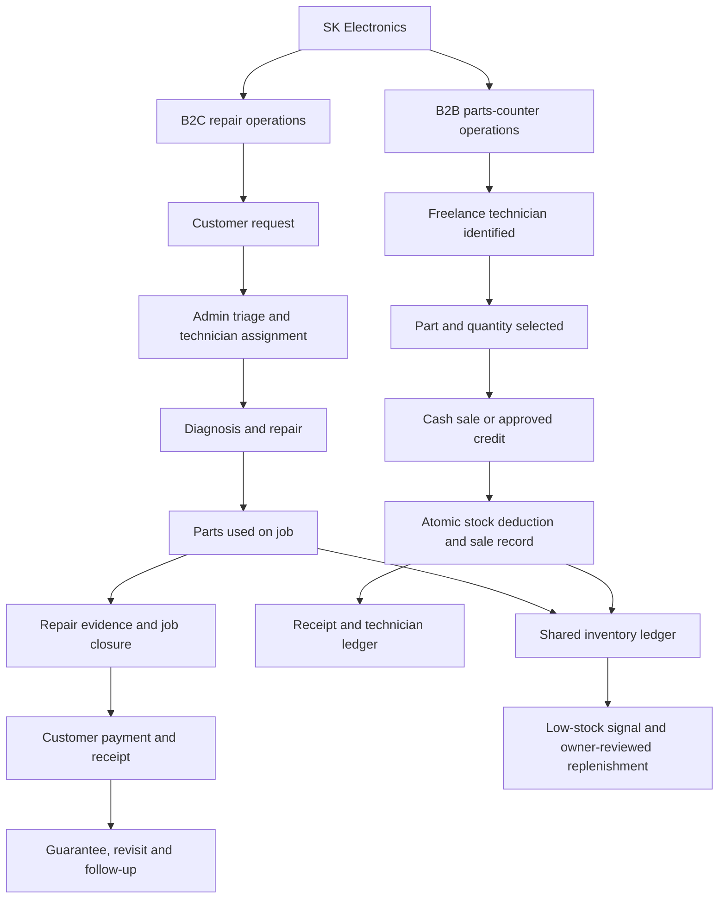

# ServiceOS / Taurus (wrenchy.in)

<!-- GitHub alternative section retained for later consolidation -->

---

<div align="center">

<!-- End of retained GitHub alternative section -->

# Wrenchy — Service & Spare-Parts Operations Platform

### ServiceOS backend · Java · Spring Boot · Event-driven systems · Data-driven inventory forecasting

1. **B2C repair service** — 4 hired technicians managed by admin (shop earns labor + parts margin).
2. **B2B parts shop** — sells parts to ~200 freelance technicians (shop earns parts margin only).

## Tech Stack (Current State)

| Layer | Choice |
|---|---|
| Language | Java 21 (Virtual Threads, Records, Sealed Interfaces) |
| Framework | Spring Boot 3.3.5 + Spring Cloud 2023.0.3 |
| Database | PostgreSQL 16 (database-per-service: 7 databases on one server instance, each in its `public` schema) |
| Cache | Redis 7 |
| Messaging | Kafka 3.7 |
| Frontend | React 19 + Tailwind CSS |
| Payments | Razorpay |
| WhatsApp | Notification-service channel (mechanism unverified — see PROJECT_CONTEXT.md §10) |
| SMS | Notification-service channel (provider unverified — see PROJECT_CONTEXT.md §10) |
| Storage | Cloudinary |
| Hosting | Not currently decided — Postgres/Redis/Kafka run self-hosted via Docker Compose in local/dev |
| CI/CD | GitHub Actions (path-filtered per-service builds) |

<!-- GitHub alternative section retained for later consolidation -->

---

Wrenchy is being built around the real operating needs of a home-appliance repair and spare-parts business: coordinating service jobs, technicians, parts, collections, and follow-up without relying on disconnected paper records.

[](https://wrenchy.in/)
[](https://github.com/24bet10066/Taurus)
[](https://dev.java/)
[](https://spring.io/projects/spring-boot)

</div>

<!-- End of retained GitHub alternative section -->

---

## Contents

- [1. The business problem](#1-the-business-problem)
- [2. The two business workflows](#2-the-two-business-workflows)
- [3. End-to-end repair workflow](#3-end-to-end-repair-workflow)
- [4. Spare-parts sales workflow](#4-spare-parts-sales-workflow)
- [5. Inventory, cash, and day-end control](#5-inventory-cash-and-day-end-control)
- [6. Roles and access boundaries](#6-roles-and-access-boundaries)
- [7. Architecture](#7-architecture)
- [8. Algorithms, forecasting and MLOps](#8-algorithms-forecasting-and-mlops)
- [9. Implementation status and roadmap](#9-implementation-status-and-roadmap)
- [10. Local development](#10-local-development)
- [11. Production-readiness checklist](#11-production-readiness-checklist)
- [12. Privacy and repository notes](#12-privacy-and-repository-notes)

## 1. The business problem

The first intended operating environment is SK Electronics, a home-appliance repair and spare-parts business in Banda, Uttar Pradesh. The shop has two connected sources of work and revenue:

## Job State Machine

<!-- GitHub alternative section retained for later consolidation -->

---

| Business line | Who it serves | How the work and money flow |
|---|---|---|
| **B2C repair service** | Households needing an appliance repaired | A customer requests a repair; the shop coordinates a hired technician; the job, parts used, collection, and follow-up are recorded. The business earns service/labour income and the applicable parts margin. |
| **B2B spare-parts shop** | Independent/freelance technicians buying parts | A technician buys parts at the counter; the sale reduces stock and creates a cash receipt or an approved credit balance. The shop earns the parts margin. |

<!-- End of retained GitHub alternative section -->

The product's purpose is operational control, not technology for its own sake. A useful system should answer practical questions reliably:

- Which jobs are new, assigned, in progress, completed, awaiting parts, or due for a revisit?
- Which technician is responsible for a job, and what happened during the visit?
- Which part was sold or used, in what quantity, and against which job or sale?
- How much money was collected, by whom, through which method, and what is still outstanding?
- Which freelance technicians owe the shop money, and which hired technicians must settle collections?
- Which items are low in stock, and what needs the owner's approval before ordering?

**Product naming:** Wrenchy is the customer-facing name; ServiceOS is the backend/system name in the code; `Taurus` is the current GitHub repository name.

## 2. The two business workflows

The system supports two different transaction types. They should share consistent customer/technician identities, part records, stock ledgers, payments, and reporting where the business rules allow it, but their money flows must not be mixed.



The diagram describes the operating model. The demand-forecasting pipeline is documented as implemented in Section 8; the diagram does not imply that every repair, payment, settlement, or counter-sales step is fully automated in production.

## 3. End-to-end repair workflow

### 3.1 Request intake

A repair request can originate from the website or from a phone/walk-in enquiry handled by the shop. The existing planning notes describe a manual **Log call** flow: staff capture basic customer/appliance information, then send a WhatsApp message containing a prefilled booking link so the customer can complete missing details.

The job record should preserve, at minimum, the customer's contact details, appliance, reported fault, area/address, requested time, request source, and a stable job identifier. Validate required fields and block dates in the past. Keep customer information restricted to staff who need it.

### 3.2 Admin review and assignment

The admin reviews the request, checks whether the customer or appliance already exists, confirms practical details, and assigns an appropriate hired technician. The job pipeline should make unassigned and overdue jobs visible instead of hiding them in chat history.

The repository's design notes describe a priority-based assignment score using skill, workload, and trust. Treat this as decision support, not unquestionable authority: the admin must be able to see the reason for an assignment and override it when real-world availability or customer constraints require it.

### 3.3 Technician visit

The assigned technician opens the technician interface/PWA, checks the job, contacts the customer, and updates the job as work progresses. The state model currently documented in the repository is:

```text
REQUESTED → ASSIGNED → IN_TRANSIT → AT_CUSTOMER → DIAGNOSING
                                                   ├─ PARTS_NEEDED → IN_PROGRESS
                                                   └─ IN_PROGRESS → COMPLETED → REVISIT_NEEDED

CANCELLED may be reached from the applicable states, subject to the implemented transition rules.
```

## Key DSA Decisions

- **Job assignment**: Priority queue, score = skill 50% + workload 30% + trust 20%.
- **Parts search**: In-memory Trie (O(k) prefix) + PostgreSQL full-text fallback.
- **Inventory forecast**: Exponential Weighted Moving Average, α = 0.30.
- **Freelancer trust**: Composite (payment 40% + frequency 30% + tenure 20% + volume 10%) → credit limit.
- **Batch traceability**: SHA-256 hash chain.

## Build & Local Development

<!-- GitHub alternative section retained for later consolidation -->

---

The job history should capture who made each change, when it happened, and the reason for cancellations, reassignment, parts requests, or revisits. A status field alone is not a sufficient audit trail.

### 3.4 Diagnosis and parts usage

The technician records the diagnosis and identifies any required part. The workflow should distinguish:

- a part that is available and used on the job;
- a part that is not available and must be sourced;
- a part that was considered but not used; and
- a part returned or replaced after an incorrect selection.

A part used on a repair must be linked to the job and recorded once in the inventory ledger. The stock deduction must be transaction-safe so that simultaneous sales or job updates cannot silently oversell the same units. A shortage should create a visible exception for the admin rather than letting the job disappear into a chat.

<!-- End of retained GitHub alternative section -->

### 3.5 Completion evidence and payment

# Spin up local Postgres, Redis, Kafka
docker compose up -d

# Run a service
./mvnw -pl auth-service spring-boot:run
```

## Environment Variables

Copy `.env.example` to `.env` and fill in:

- `JWT_SECRET` — 32+ random bytes
- `DATABASE_URL` — PostgreSQL connection string
- `REDIS_URL` — Redis connection string
- `KAFKA_BOOTSTRAP` — Kafka bootstrap server (self-hosted; `localhost:9092` in local dev)
- `RAZORPAY_*` — Razorpay credentials
- `WA_PHONE_NUMBER_ID`, `WA_ACCESS_TOKEN` — Meta WhatsApp Cloud API
- `FAST2SMS_API_KEY`, `FAST2SMS_SENDER` — Fast2SMS
- `CLOUDINARY_*` — Cloudinary credentials

<!-- GitHub alternative section retained for later consolidation -->

---

**Target control:** a technician should not be able to close a job merely by tapping “Completed.” The completion flow should capture the repair result, required evidence (such as an appliance/repair photo where appropriate), parts used, final charge, amount collected, payment method, and any balance still due. The job should close only after the required data is saved successfully.

The supplied roadmap snapshot specifically identified completion without proof and without an enforced photo/amount capture as a risk. This control is therefore a high-priority roadmap item unless the current production version has since closed the gap.

Payment handling should record the amount, method (cash/online), timestamp, collector, linked job, and provider reference for online payments where relevant. A payment notification should be generated from the recorded transaction, not from a separate untracked manual message. Webhook/event handling must be idempotent so retries do not create duplicate receipts or double-count payments.

### 3.6 Revisit, guarantee and customer follow-up

When a completed repair needs another visit, create a revisit linked to the original job. Preserve the original diagnosis, work performed, parts used, amount collected, and guarantee terms. Record whether the revisit is covered or chargeable and who approved that decision. Do not overwrite the history of the original repair.

Automated post-service messages, reviews, and repeat-customer reminders are useful only after the booking, completion, payment, and contact records are reliable. Respect the customer's communication preferences and provide a manual fallback when a message fails.

## 4. Spare-parts sales workflow

This workflow is for freelance technicians purchasing parts from the shop, not for public customers browsing consumer e-commerce prices.

1. **Identify the buyer.** Select the technician's account so the sale and any credit are assigned to the right person.
2. **Select the part.** Search by SKU/name/compatible appliance, confirm the correct item, and display the applicable technician price and available stock.
3. **Record quantity and terms.** Enter quantity and choose cash payment or credit only when the technician is eligible and the shop's policy permits it.
4. **Commit one transaction.** Save the sale, update stock atomically, record payment or receivable, and prevent duplicate submission from creating a second sale.
5. **Issue a receipt.** Provide a receipt showing sale ID, items, quantities, price, total, amount paid, and balance if credit was approved.
6. **Track the account.** Maintain a ledger of credit sales, repayments, adjustments, and the remaining balance; don't rely on a single editable “outstanding amount” without transaction history.
7. **Handle low stock.** Generate an alert when the configured threshold is crossed. A future supplier-ordering feature should prepare a draft order for the owner to review and send, not place purchases without approval.

The planning notes state that the parts-sale backend endpoint and atomic stock deduction already existed at that snapshot, while the counter UI was missing. Re-test the current branch before treating that status as current.

## 5. Inventory, cash, and day-end control

### Inventory must have a movement history

A reliable inventory ledger should account for opening stock, supplier receipts, B2B sales, parts consumed on repair jobs, returns, damaged/adjusted stock, and approved corrections. Every movement should include the part, quantity change, reason, timestamp, and source transaction. Keep physical counts and system counts reconcilable.

Supplier replenishment should follow a controlled sequence: low-stock signal → owner reviews demand and available cash → draft order is prepared → supplier order is approved/sent → received quantities and costs are recorded → stock is updated. The owner remains responsible for the purchasing decision.

### Keep the money flows separate

The system should report these separately:

- **Repair operations:** labour/service charges, parts charged to the customer, amounts collected, and balances due.
- **B2B parts shop:** parts sales, cost of the sold stock where recorded, cash received, credit issued, and repayments received.
- **Technician settlements:** cash collected by each hired technician on the shop's behalf versus cash actually deposited with the shop.
- **Online payments:** successful provider-confirmed payments, failed/pending payments, refunds where supported, and reconciliation references.

Collections are not the same thing as profit. A credit sale is not cash received, gross sales are not margin, and money held by a technician is not yet money deposited in the shop.

### Daily owner view

The intended day-end view should answer: jobs created/assigned/completed; jobs still open; cash and online collections separately; pending customer balances; hired-technician cash awaiting settlement; parts sold on cash/credit; outstanding freelance-technician credit; low-stock items; revisits/complaints; and notification failures. A scheduled daily digest can come later after these source records reconcile correctly.

## 6. Roles and access boundaries

The repository currently documents these roles:

| Role | Primary responsibilities | Access boundary |
|---|---|---|
| `ADMIN` | Review bookings, assign jobs, manage customers/technicians/parts, review collections, resolve exceptions | Access to operational controls and sensitive business reporting according to least privilege |
| `TECHNICIAN_HIRED` | View assigned jobs, update visit/job progress, record diagnosis, parts used, evidence, and collections according to policy | Only the jobs and customer details needed for assigned work; no unrestricted shop-wide financial data |
| `TECHNICIAN_FREE` | Browse technician-facing parts catalogue, buy parts, see own receipts and approved credit balance | Own account and transactions; no customer private details or other technicians' ledgers |
| `CUSTOMER` / public booking user | Submit a service request and receive relevant confirmations | Only their own request/communication paths; parts-shop internal pricing and technician financial data remain private |

Actual frontend screens and API permissions should be tested against these intended boundaries. A role name in code is not proof that every endpoint is correctly protected.

## 7. Architecture

The repository contains a Java 21 Maven multi-module project with nine Spring Boot applications and a shared library.

| Application | Port in current project documentation | Responsibility |
|---|---:|---|
| `api-gateway` | 8080 | External API entry point and routing |
| `auth-service` | 8081 | OTP/JWT identity and roles |
| `job-service` | 8082 | Repair job lifecycle, state transitions, assignment |
| `parts-service` | 8083 | Part catalogue, inventory and parts sales |
| `customer-service` | 8084 | Customer, appliance and maintenance-contract data |
| `technician-service` | 8085 | Hired/freelance technician profiles, skills and availability |
| `notification-service` | 8086 | Asynchronous customer/admin messages |
| `payment-service` | 8087 | Payment records, online payment integration and cash receipts |
| `analytics-service` | 8088 | Owner dashboard data and forecasting-related calculations |
| `shared-lib` | — | Shared event records, DTOs, enums, exceptions and result types |

### Event-driven integration

Repository documentation lists Kafka event names such as `job.created`, `job.status.changed`, `job.completed`, `inventory.reorder-alert`, `parts.sold`, `payment.received`, `credit.updated`, and `customer.amc-opportunity`. Events should communicate completed facts; consumers need retry handling, idempotency, dead-letter/error visibility where appropriate, and a way to investigate failed notifications.

### Local infrastructure

The current `docker-compose.yml` is explicitly marked for **local development only**. It starts PostgreSQL 16, Redis 7, Kafka 3.7, and Kafka UI; it does not itself start all nine Spring Boot applications. `scripts/init-databases.sql` currently creates separate databases for the services listed there. The `.env.example` contains per-service `*_DB_URL` values and references Confluent Cloud for production Kafka.

Do not describe production as “one database with schema-per-service,” “all services self-hosted on Azure,” or any other provider topology until the active production configuration has been checked. The current repository documentation has conflicting/older deployment descriptions; this must be reconciled before publishing a definitive production architecture.

## 8. Algorithms, forecasting and MLOps

The platform combines deterministic business rules with data-driven inventory planning. The algorithms below serve distinct purposes; ML is intentionally limited to spare-parts demand forecasting.

- **Technician assignment:** priority-queue-based candidate ordering with a documented score weighted toward skill (50%), workload (30%), and trust (20%). The admin can review and override assignments; ML is not used to decide technician assignments.
- **Part search:** Trie-based prefix search with a PostgreSQL search fallback. A Trie prefix lookup is typically proportional to the searched prefix length, while total latency also depends on result retrieval and data access.
- **EWMA baseline:** an Exponentially Weighted Moving Average with alpha `0.30` provides a simple forecasting baseline for parts with enough recent movement and remains the fallback for sparse histories.
- **Freelancer trust/credit:** documented factors include payment behaviour, purchase frequency, tenure, and volume. Credit limits and prices are business policies; decision reasons and owner overrides should remain visible and auditable.
- **Batch traceability:** the design notes describe a SHA-256 hash chain. Document exactly what is hashed and test tamper detection before presenting it as an audit guarantee.

### Spare-parts demand forecasting pipeline

The MLOps pipeline supports **spare-parts demand forecasting only**. It does not make payment, authentication, or technician-assignment decisions. Its purpose is to produce forecasts that are measurable, explainable, and safe to use in inventory planning.

The pipeline follows this controlled lifecycle:

1. **Ingest real operational history.** Read genuine parts and job/inventory records and report the available row counts, date range, and relevant data-quality limitations. Training data must not be fabricated or inserted into a real business database.
2. **Check data sufficiency.** Determine whether each part has enough reliable history for meaningful model training and evaluation. Parts with insufficient history use the EWMA fallback.
3. **Train and evaluate a candidate.** Evaluate the candidate model against the EWMA baseline using comparable historical evaluation periods and the same documented forecast-error metric.
4. **Apply an acceptance gate.** Accept a candidate only when it improves on the baseline under the configured evaluation rule. A model that fails to beat the baseline is rejected rather than promoted just because it is more complex.
5. **Expose the reasoning.** Forecast results should show the relevant history, data sufficiency or fallback status, and the model/baseline evaluation that supports the recommendation. Avoid presenting a forecast as an unexplained instruction.
6. **Require human purchasing approval.** Forecasts can inform replenishment recommendations, but the owner must approve an order before a purchase is placed. The model does not autonomously order stock.

### Evaluation integrity and expected outcomes

The pipeline mechanics are implemented, including ingestion, training/evaluation flow, baseline comparison, candidate rejection, and sparse-history fallback. **Pipeline implementation does not by itself prove that an ML model improves real forecasts.** The accepted-model status depends on genuine historical data and evaluation results.

- If available real history is sufficient, report the measured candidate-versus-EWMA result from the actual evaluation.
- If history is insufficient, make the status explicit: **“Pipeline validated on insufficient data; no real performance result yet.”** In that situation, use the EWMA fallback and do not publish performance numbers derived from synthetic or fabricated data.
- Do not claim forecast accuracy, improvement, savings, or business impact unless supported by reproducible results from real data.

The design principle is simple: prefer a reliable baseline over an unproven model, preserve human control over purchases, and increase automation only when real evidence supports it. No generative-AI feature is required for this workflow.

## 9. Implementation status and roadmap

The spare-parts demand-forecasting pipeline described in Section 8 is treated as implemented: it covers real-data ingestion, data-sufficiency checks, candidate evaluation against EWMA, rejection when the candidate does not meet the acceptance rule, sparse-history fallback, forecast reasoning, and human approval before replenishment. Its **real predictive performance remains data-dependent**; no model win or numerical result should be claimed without a sufficient real dataset and reproducible evaluation.

Other workflow items below come from a roadmap snapshot dated **17 May 2026**. That snapshot is historical context, not proof of current production status. Verify the current code and live workflows before marking those items complete.

### Reported as shipped in that snapshot — re-verify

- Booking-field mapping and past-date validation fixes.
- Manual Log call flow with a WhatsApp booking-link prefill.
- Customer search/history page.
- Day-end cash/online/total tile and pending-collection alert.
- Payment collection flow with a WhatsApp receipt.
- Gateway route fix and a payment-received notification consumer.

### Highest-priority operational gaps identified in that snapshot — re-check first

1. **Completion evidence:** require repair proof/required photo, parts used, and the amount collected before a hired technician closes a job.
2. **Walk-in parts-counter UI:** let staff choose a freelance technician, search parts, select quantity, record cash/approved credit, and issue a receipt. The snapshot said the API existed but there was no UI.
3. **Hired-technician settlement:** reconcile cash recorded as collected by each technician against deposits actually made to the shop.
4. **Inventory and job auditability:** make stock movements, job status history, reassignment, completion evidence, and payment changes traceable.

### Roadmap file

See [`ROADMAP.md`](ROADMAP.md) for priority order, business rationale, acceptance criteria, and launch gates. The remaining operational roadmap favours loss prevention and trustworthy daily operations over speculative AI features or an architecture rewrite. The forecasting pipeline does not remove the need to verify inventory, payment, permissions, and purchasing controls end to end.

## 10. Local development

### Prerequisites

- JDK 21
- Maven (the repository may also contain a Maven wrapper, `./mvnw`)
- Docker and Docker Compose
- Node.js/npm for the frontend, if working on it

### Start local infrastructure

From the repository root:

```bash
docker compose up -d
```

This starts the dependencies defined by `docker-compose.yml`; it does **not** automatically start all application modules. Configure the per-service environment variables in a local `.env` file based on `.env.example`, and ensure database names, Kafka broker addresses, and service URLs agree with the actual local configuration.

### Build the Maven modules

```bash
./mvnw clean install
```

To build the auth service and its module dependencies:

```bash
./mvnw -pl auth-service -am clean install
```

To run one Spring Boot module during development:

<!-- End of retained GitHub alternative section -->

```bash
./mvnw -pl auth-service spring-boot:run
```

Use the equivalent module command for the application you're working on. Follow the actual service configuration and startup scripts in the repository when running the full stack.

## 11. Production-readiness checklist

Before relying on the application for daily shop operations, verify all of the following with test transactions:

- [ ] A request can be created, reviewed, assigned, updated, and found again by customer/job ID.
- [ ] Two staff actions cannot assign the same job inconsistently or silently lose a status update.
- [ ] Parts used on a job and parts sold at the counter reduce stock exactly once.
- [ ] An unsuccessful payment, duplicate webhook, or notification retry cannot double-count a payment or sale.
- [ ] Job completion requires all evidence and financial details mandated by shop policy.
- [ ] Cash held by hired technicians can be reconciled against actual deposits.
- [ ] Staff can identify pending collections, credit balances, stock discrepancies, and low-stock parts.
- [ ] A database backup can be restored; migrations and startup ordering are tested.
- [ ] Secrets are stored in the deployment environment, never committed to Git.
- [ ] Role boundaries are verified at the API level, not only by hiding frontend buttons.
- [ ] Notification failure is visible, retryable, and does not block the core transaction silently.
- [ ] A human owner can review unusual credit, refund, stock-adjustment, and supplier-order decisions.
- [ ] Forecast candidates are compared with EWMA on genuine historical data, and candidates that fail the acceptance rule are rejected.
- [ ] Parts with insufficient history use EWMA, and the pipeline displays the explicit no-real-result status when data is insufficient.
- [ ] Forecast explanations are available to the user reviewing replenishment recommendations.
- [ ] No supplier order is placed without explicit human approval.
- [ ] The seven launch smoke tests in the internal roadmap pass against the actual deployment.

## 12. Privacy and repository notes

This software may handle customer phone numbers and addresses, technician records, credit balances, and payment references. Use synthetic data in public examples, restrict access to operational data, avoid logging secrets or unnecessary personal data, and never commit a populated `.env` file.

The repository currently describes the licence as **proprietary/internal use**. If the code is intended to be a public portfolio, decide explicitly what can be shared. Public visibility is not a substitute for a clear licence or for removing operational secrets and private customer data.

---

**Guiding principle:** understand the physical workflow first, record each meaningful action exactly once, reconcile stock and money, then automate the repetitive decisions that the data can support.