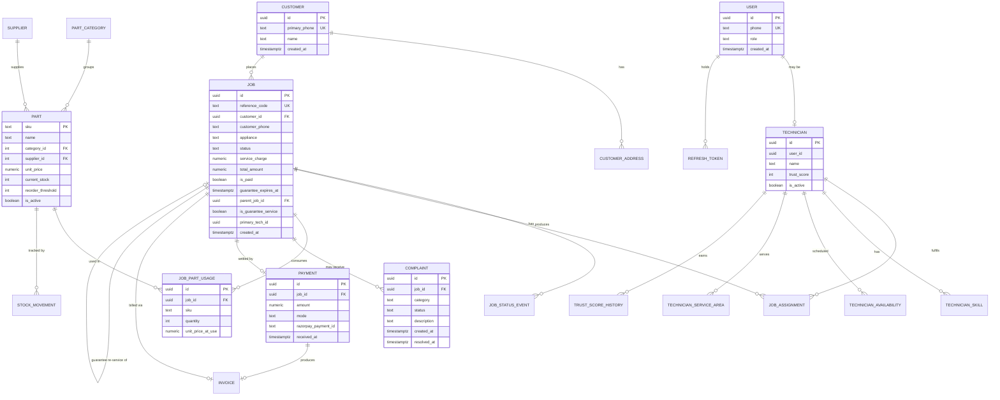

# Database Design Document

## wrenchy.in — Guarantee-Backed Home Appliance Repair and Spare-Parts Platform

| Field | Value |
|---|---|
| Document Type | Database Design Document |
| Companion To | SRS v1.0 (`docs/SRS.md`), System Design v1.0 (`docs/SYSTEM_DESIGN.md`) |
| Version | 1.0 |
| Status | Draft for review |
| Author | [ADD: Author Name] |
| Last Updated | [ADD: YYYY-MM-DD] |
| Target Engine | PostgreSQL 16 |

---

## Table of Contents

1. Introduction
2. Conceptual Model and ER Diagram
3. Per-Service Schema Ownership
4. Logical Schema (table-by-table)
5. Normalization and Deliberate Denormalization
6. Indexing Strategy
7. Key Relationships Explained
8. Data Integrity, Lifecycle, and Audit
9. Migration and Evolution
10. Appendix: Type Conventions

---

## 1. Introduction

### 1.1 Purpose

This document defines the physical and logical database design for wrenchy.in. It is derived directly from the entities listed in the SRS (Section 3) and the data-management decisions made in the System Design Document (Section 5).

### 1.2 Scope

In scope: every persistent table that backs the nine microservices, including primary keys, foreign keys, constraints, indexes, audit columns, and the rationale for each non-obvious choice. Out of scope: Redis key schemas (documented inline in service code) and Kafka event payloads (covered in the System Design).

### 1.3 Anchor Decision From the System Design

The System Design Document (Section 5.1) established the following: **one PostgreSQL 16 instance, eight logical schemas (one per service that owns data), no foreign keys across schema boundaries.** Cross-schema relationships exist as *logical* references — validated by application code, not by database constraints — so that a future split into database-per-service is a configuration change rather than a refactor.

This document honours that decision throughout.

### 1.4 Source Material

Entities, attributes, and required access patterns are taken from:

- SRS Section 3 (Functional Requirements) — defines what each service must do.
- SRS Section 6.2 (Data Retention) — defines how long each table's data must persist.
- System Design Section 3 (Service Breakdown) — defines which service owns what data.
- System Design Section 5 (Data Management) — defines the shared-instance, schema-per-service pattern.

---

## 2. Conceptual Model and ER Diagram

The high-level entity model focuses on the eight primary entities that drive the business and the relationships that matter operationally.

Several supporting entities (`stock_movements`, `notification_dispatch_log`, `customer_phone_history`, `job_status_events`, `trust_score_history`) are append-only audit tables and are described in Section 4 but omitted from the ER diagram to keep the conceptual model legible.

---

## 3. Per-Service Schema Ownership

Each service owns exactly one PostgreSQL schema and writes only to that schema. Reads from other services happen via REST or Kafka, **never** by directly querying another schema. This convention is the application-level contract; the database does not enforce it (no Postgres `REVOKE` is configured in v1.0).

| Service | Schema | Tables Owned |
|---|---|---|
| `auth-service` | `auth` | `users`, `refresh_tokens` |
| `job-service` | `job` | `jobs`, `job_status_events`, `job_assignments`, `job_part_usage`, `job_photos`, `complaints` |
| `parts-service` | `parts` | `parts`, `part_categories`, `suppliers`, `stock_movements` |
| `customer-service` | `customer` | `customers`, `customer_addresses`, `customer_phone_history` |
| `technician-service` | `technician` | `technicians`, `technician_skills`, `technician_availability`, `technician_service_areas`, `trust_score_history` |
| `notification-service` | `notification` | `notification_dispatch_log` |
| `payment-service` | `payment` | `payments`, `razorpay_orders`, `invoices` |
| `analytics-service` | `analytics` | Materialised views only — no base tables |

**[FACT]** The `gateway` service is stateless and owns no tables.

---

## 4. Logical Schema

Type conventions used throughout: see Appendix. Money columns are `NUMERIC(10, 2)`. Timestamps are `TIMESTAMPTZ`. Surrogate keys are `UUID` (Postgres `uuid` type, v7 time-ordered generated by application via `Uuids.timeBased()` or Postgres `gen_random_uuid()`). String enums are `TEXT` with a `CHECK` constraint listing the legal values — explicit, queryable, migratable, and unlike Postgres `ENUM` types they survive cross-service migrations cleanly.

### 4.1 `auth` schema

#### `auth.users`

| Column | Type | Constraints | Notes |
|---|---|---|---|
| `id` | UUID | PK | App-generated UUIDv7. |
| `phone` | TEXT | NOT NULL, UNIQUE, CHECK length = 10 | 10-digit Indian mobile (no country code stored). |
| `role` | TEXT | NOT NULL, CHECK IN ('CUSTOMER', 'TECHNICIAN', 'ADMIN', 'OWNER') | Single role per user in v1.0. |
| `is_active` | BOOLEAN | NOT NULL, DEFAULT TRUE | Soft-deactivation flag. |
| `created_at` | TIMESTAMPTZ | NOT NULL, DEFAULT now() | |
| `updated_at` | TIMESTAMPTZ | NOT NULL, DEFAULT now() | Updated by Hibernate `@UpdateTimestamp`. |
| `last_login_at` | TIMESTAMPTZ | NULL | |

#### `auth.refresh_tokens`

| Column | Type | Constraints | Notes |
|---|---|---|---|
| `id` | UUID | PK | |
| `user_id` | UUID | NOT NULL, FK → `auth.users(id)` ON DELETE CASCADE | |
| `token_hash` | TEXT | NOT NULL, UNIQUE | SHA-256 of the raw token; raw token never stored. |
| `issued_at` | TIMESTAMPTZ | NOT NULL, DEFAULT now() | |
| `expires_at` | TIMESTAMPTZ | NOT NULL | |
| `revoked_at` | TIMESTAMPTZ | NULL | Soft-revocation. Blacklist also held in Redis for fast check. |
| `user_agent` | TEXT | NULL | For session inventory. |

**[FACT]** OTP records live in Redis, not Postgres (SRS NFR-SEC-02). Redis key: `otp:{phone}` with 5-minute TTL.

---

### 4.2 `customer` schema

#### `customer.customers`

| Column | Type | Constraints | Notes |
|---|---|---|---|
| `id` | UUID | PK | |
| `primary_phone` | TEXT | NOT NULL, UNIQUE, CHECK length = 10 | Canonical contact. |
| `name` | TEXT | NOT NULL | Customer-supplied; mutable. |
| `created_at` | TIMESTAMPTZ | NOT NULL, DEFAULT now() | |
| `updated_at` | TIMESTAMPTZ | NOT NULL, DEFAULT now() | |
| `is_deleted` | BOOLEAN | NOT NULL, DEFAULT FALSE | Per DPDP Act right-to-erasure; rows are anonymised, not hard-deleted (audit need). |

#### `customer.customer_addresses`

| Column | Type | Constraints | Notes |
|---|---|---|---|
| `id` | UUID | PK | |
| `customer_id` | UUID | NOT NULL, FK → `customer.customers(id)` ON DELETE CASCADE | |
| `line1` | TEXT | NOT NULL | |
| `landmark` | TEXT | NULL | |
| `city` | TEXT | NOT NULL, DEFAULT 'Banda' | |
| `pincode` | TEXT | NOT NULL, CHECK length = 6 | |
| `is_default` | BOOLEAN | NOT NULL, DEFAULT FALSE | |
| `created_at` | TIMESTAMPTZ | NOT NULL, DEFAULT now() | |

#### `customer.customer_phone_history`

Append-only audit of every phone seen for a customer (a single customer occasionally calls from a relative's phone).

| Column | Type | Constraints |
|---|---|---|
| `id` | UUID | PK |
| `customer_id` | UUID | NOT NULL, FK → `customer.customers(id)` |
| `phone` | TEXT | NOT NULL, CHECK length = 10 |
| `observed_at` | TIMESTAMPTZ | NOT NULL, DEFAULT now() |

---

### 4.3 `job` schema

#### `job.jobs`

| Column | Type | Constraints | Notes |
|---|---|---|---|
| `id` | UUID | PK | |
| `reference_code` | TEXT | NOT NULL, UNIQUE | 6-character alphanumeric; what customers see. |
| `customer_id` | UUID | NULL | Logical FK to `customer.customers(id)`. App-validated. Nullable because anonymous bookings can pre-date customer record creation. |
| `customer_phone` | TEXT | NOT NULL, CHECK length = 10 | **Denormalised** from customer — see Section 5.2. |
| `customer_name_snapshot` | TEXT | NOT NULL | Name at booking time. Frozen; customer rename does not back-propagate. |
| `appliance` | TEXT | NOT NULL, CHECK IN ('AC', 'FRIDGE', 'WASHING_MACHINE', 'RO', 'WATER_HEATER', 'OTHER') | |
| `appliance_brand` | TEXT | NULL | Customer-reported. |
| `problem` | TEXT | NOT NULL | Free text. |
| `status` | TEXT | NOT NULL, CHECK IN ('REQUESTED', 'ASSIGNED', 'IN_TRANSIT', 'AT_CUSTOMER', 'IN_PROGRESS', 'PARTS_NEEDED', 'COMPLETED', 'CANCELLED') | Current state in the FR-JOB-03 state machine. |
| `address_line1` | TEXT | NOT NULL | Snapshot at booking; address can change later but the job stays put. |
| `address_landmark` | TEXT | NULL | |
| `address_pincode` | TEXT | NOT NULL, CHECK length = 6 | |
| `scheduled_at` | TIMESTAMPTZ | NULL | Customer-requested slot; null = "as soon as possible". |
| `primary_tech_id` | UUID | NULL | Logical FK to `technician.technicians(id)`. |
| `assistant_tech_id` | UUID | NULL | Logical FK to `technician.technicians(id)`. |
| `service_charge` | NUMERIC(10,2) | NOT NULL, DEFAULT 0 | Set at COMPLETED; zero for guarantee re-services. |
| `total_amount` | NUMERIC(10,2) | NOT NULL, DEFAULT 0 | **Denormalised** = `service_charge` + Σ(`job_part_usage.unit_price_at_use × quantity`). Computed on COMPLETED transition. |
| `is_paid` | BOOLEAN | NOT NULL, DEFAULT FALSE | Set by `payment.received` consumer. |
| `parent_job_id` | UUID | NULL, FK → `job.jobs(id)` | Self-reference. Set when this job is a guarantee re-service. |
| `is_guarantee_service` | BOOLEAN | NOT NULL, DEFAULT FALSE | True iff `parent_job_id` is not null. |
| `guarantee_expires_at` | TIMESTAMPTZ | NULL | Set on transition to COMPLETED = `completed_at + interval`. |
| `created_at` | TIMESTAMPTZ | NOT NULL, DEFAULT now() | |
| `updated_at` | TIMESTAMPTZ | NOT NULL, DEFAULT now() | |
| `completed_at` | TIMESTAMPTZ | NULL | |
| `cancelled_at` | TIMESTAMPTZ | NULL | |
| `cancellation_reason` | TEXT | NULL | |

#### `job.job_status_events`

Append-only audit trail. Never updated, never deleted.

| Column | Type | Constraints | Notes |
|---|---|---|---|
| `id` | UUID | PK | |
| `job_id` | UUID | NOT NULL, FK → `job.jobs(id)` ON DELETE RESTRICT | Jobs are never deleted, but RESTRICT keeps the invariant honest. |
| `from_status` | TEXT | NULL | Null for the initial REQUESTED event. |
| `to_status` | TEXT | NOT NULL | |
| `actor_user_id` | UUID | NULL | Null for system transitions. |
| `actor_role` | TEXT | NOT NULL, CHECK IN ('CUSTOMER', 'TECHNICIAN', 'ADMIN', 'OWNER', 'SYSTEM') | |
| `reason` | TEXT | NULL | |
| `created_at` | TIMESTAMPTZ | NOT NULL, DEFAULT now() | |

#### `job.job_assignments`

| Column | Type | Constraints | Notes |
|---|---|---|---|
| `id` | UUID | PK | |
| `job_id` | UUID | NOT NULL, FK → `job.jobs(id)` ON DELETE CASCADE | |
| `technician_id` | UUID | NOT NULL | Logical FK to `technician.technicians(id)`. |
| `role` | TEXT | NOT NULL, CHECK IN ('PRIMARY', 'ASSISTANT') | |
| `assigned_at` | TIMESTAMPTZ | NOT NULL, DEFAULT now() | |
| `assigned_by_user_id` | UUID | NOT NULL | Who performed the assignment. |
| `unassigned_at` | TIMESTAMPTZ | NULL | Soft removal — supports the audit need to see who *was* on a job. |

#### `job.job_part_usage`

| Column | Type | Constraints | Notes |
|---|---|---|---|
| `id` | UUID | PK | |
| `job_id` | UUID | NOT NULL, FK → `job.jobs(id)` ON DELETE RESTRICT | |
| `sku` | TEXT | NOT NULL | Logical FK to `parts.parts(sku)`. App-validated. |
| `quantity` | INTEGER | NOT NULL, CHECK > 0 | |
| `unit_price_at_use` | NUMERIC(10,2) | NOT NULL, CHECK >= 0 | **Snapshot** of price at time of use — see Section 5.2. |
| `recorded_by_user_id` | UUID | NOT NULL | |
| `created_at` | TIMESTAMPTZ | NOT NULL, DEFAULT now() | |

#### `job.job_photos`

| Column | Type | Constraints | Notes |
|---|---|---|---|
| `id` | UUID | PK | |
| `job_id` | UUID | NOT NULL, FK → `job.jobs(id)` ON DELETE CASCADE | |
| `kind` | TEXT | NOT NULL, CHECK IN ('BEFORE', 'AFTER') | |
| `cloudinary_secure_url` | TEXT | NOT NULL | |
| `uploaded_by_user_id` | UUID | NOT NULL | |
| `uploaded_at` | TIMESTAMPTZ | NOT NULL, DEFAULT now() | |

#### `job.complaints`

| Column | Type | Constraints | Notes |
|---|---|---|---|
| `id` | UUID | PK | |
| `job_id` | UUID | NOT NULL, FK → `job.jobs(id)` ON DELETE RESTRICT | |
| `category` | TEXT | NOT NULL, CHECK IN ('RECURRENCE', 'BEHAVIOR', 'PRICING', 'PUNCTUALITY', 'OTHER') | |
| `description` | TEXT | NOT NULL | |
| `status` | TEXT | NOT NULL, CHECK IN ('OPEN', 'IN_REVIEW', 'RESOLVED', 'DISMISSED'), DEFAULT 'OPEN' | |
| `resolution_note` | TEXT | NULL | Required to transition to RESOLVED. |
| `resolved_by_user_id` | UUID | NULL | |
| `resolved_at` | TIMESTAMPTZ | NULL | |
| `triggered_guarantee_job_id` | UUID | NULL, FK → `job.jobs(id)` | Set when RECURRENCE complaint within guarantee window creates a linked re-service. |
| `created_at` | TIMESTAMPTZ | NOT NULL, DEFAULT now() | |

---

### 4.4 `parts` schema

#### `parts.part_categories`

| Column | Type | Constraints |
|---|---|---|
| `id` | SERIAL | PK |
| `name` | TEXT | NOT NULL, UNIQUE |
| `parent_id` | INTEGER | NULL, FK → `parts.part_categories(id)` |
| `created_at` | TIMESTAMPTZ | NOT NULL, DEFAULT now() |

#### `parts.suppliers`

| Column | Type | Constraints |
|---|---|---|
| `id` | SERIAL | PK |
| `name` | TEXT | NOT NULL, UNIQUE |
| `contact_phone` | TEXT | NULL |
| `notes` | TEXT | NULL |
| `is_active` | BOOLEAN | NOT NULL, DEFAULT TRUE |
| `created_at` | TIMESTAMPTZ | NOT NULL, DEFAULT now() |

#### `parts.parts`

| Column | Type | Constraints | Notes |
|---|---|---|---|
| `sku` | TEXT | PK | Natural key. Human-readable (e.g., `LG-FRIDGE-COMPRESSOR-1HP`). |
| `name` | TEXT | NOT NULL | |
| `category_id` | INTEGER | NOT NULL, FK → `parts.part_categories(id)` | |
| `brand` | TEXT | NULL | |
| `model_compatibility` | JSONB | NOT NULL, DEFAULT '[]' | Array of model strings. **Deliberate denormalisation** — see Section 5.2. |
| `unit_price` | NUMERIC(10,2) | NOT NULL, CHECK >= 0 | Current sell price. |
| `current_stock` | INTEGER | NOT NULL, CHECK >= 0, DEFAULT 0 | |
| `reorder_threshold` | INTEGER | NOT NULL, CHECK >= 0, DEFAULT 1 | |
| `supplier_id` | INTEGER | NULL, FK → `parts.suppliers(id)` | |
| `is_active` | BOOLEAN | NOT NULL, DEFAULT TRUE | Soft-deactivation. |
| `created_at` | TIMESTAMPTZ | NOT NULL, DEFAULT now() | |
| `updated_at` | TIMESTAMPTZ | NOT NULL, DEFAULT now() | |

#### `parts.stock_movements`

Append-only ledger. Every stock change writes a row, then atomically updates `parts.current_stock` in the same transaction.

| Column | Type | Constraints | Notes |
|---|---|---|---|
| `id` | BIGSERIAL | PK | High-volume table; BIGSERIAL beats UUID on storage. |
| `sku` | TEXT | NOT NULL, FK → `parts.parts(sku)` ON DELETE RESTRICT | |
| `movement_type` | TEXT | NOT NULL, CHECK IN ('RESTOCK', 'CONSUME', 'ADJUSTMENT', 'WRITEOFF') | |
| `quantity_delta` | INTEGER | NOT NULL | Negative for CONSUME and WRITEOFF; positive for RESTOCK; either for ADJUSTMENT. |
| `stock_after` | INTEGER | NOT NULL, CHECK >= 0 | Denormalised for fast ledger reads — see Section 5.2. |
| `reference_type` | TEXT | NULL, CHECK IN ('JOB', 'PURCHASE_ORDER', 'MANUAL_ADJUSTMENT') | |
| `reference_id` | UUID | NULL | Polymorphic by `reference_type`. |
| `note` | TEXT | NULL | |
| `performed_by_user_id` | UUID | NOT NULL | |
| `created_at` | TIMESTAMPTZ | NOT NULL, DEFAULT now() | |

---

### 4.5 `technician` schema

#### `technician.technicians`

| Column | Type | Constraints | Notes |
|---|---|---|---|
| `id` | UUID | PK | |
| `user_id` | UUID | NULL, UNIQUE | Logical FK to `auth.users(id)`. Null for freelance technicians who don't log in. |
| `name` | TEXT | NOT NULL | |
| `primary_phone` | TEXT | NOT NULL, UNIQUE, CHECK length = 10 | |
| `is_freelance` | BOOLEAN | NOT NULL, DEFAULT FALSE | |
| `is_active` | BOOLEAN | NOT NULL, DEFAULT TRUE | |
| `trust_score` | INTEGER | NOT NULL, CHECK BETWEEN 0 AND 100, DEFAULT 70 | New hires start at 70. |
| `joined_at` | DATE | NOT NULL | |
| `deactivated_at` | TIMESTAMPTZ | NULL | |
| `created_at` | TIMESTAMPTZ | NOT NULL, DEFAULT now() | |
| `updated_at` | TIMESTAMPTZ | NOT NULL, DEFAULT now() | |

#### `technician.technician_skills`

| Column | Type | Constraints |
|---|---|---|
| `technician_id` | UUID | NOT NULL, FK → `technician.technicians(id)` ON DELETE CASCADE |
| `skill_tag` | TEXT | NOT NULL, CHECK IN ('AC', 'FRIDGE', 'WASHING_MACHINE', 'RO', 'WATER_HEATER', 'ELECTRICAL', 'PLUMBING') |
| PRIMARY KEY | (`technician_id`, `skill_tag`) | |

#### `technician.technician_service_areas`

| Column | Type | Constraints |
|---|---|---|
| `technician_id` | UUID | NOT NULL, FK → `technician.technicians(id)` ON DELETE CASCADE |
| `pincode` | TEXT | NOT NULL, CHECK length = 6 |
| PRIMARY KEY | (`technician_id`, `pincode`) | |

#### `technician.technician_availability`

| Column | Type | Constraints |
|---|---|---|
| `id` | UUID | PK |
| `technician_id` | UUID | NOT NULL, FK → `technician.technicians(id)` ON DELETE CASCADE |
| `day_of_week` | SMALLINT | NOT NULL, CHECK BETWEEN 0 AND 6 |
| `start_time` | TIME | NOT NULL |
| `end_time` | TIME | NOT NULL, CHECK end_time > start_time |
| `is_active` | BOOLEAN | NOT NULL, DEFAULT TRUE |

#### `technician.trust_score_history`

Append-only. Every trust-score change writes a row.

| Column | Type | Constraints |
|---|---|---|
| `id` | BIGSERIAL | PK |
| `technician_id` | UUID | NOT NULL, FK → `technician.technicians(id)` ON DELETE CASCADE |
| `score_before` | INTEGER | NOT NULL |
| `score_after` | INTEGER | NOT NULL |
| `delta` | INTEGER | NOT NULL |
| `reason` | TEXT | NOT NULL, CHECK IN ('JOB_COMPLETED', 'COMPLAINT_RECURRENCE', 'COMPLAINT_BEHAVIOR', 'NO_SHOW', 'RATING_RECEIVED', 'MANUAL_ADJUSTMENT') |
| `reference_id` | UUID | NULL |
| `created_at` | TIMESTAMPTZ | NOT NULL, DEFAULT now() |

---

### 4.6 `notification` schema

#### `notification.notification_dispatch_log`

| Column | Type | Constraints | Notes |
|---|---|---|---|
| `id` | BIGSERIAL | PK | |
| `event_id` | UUID | NOT NULL | Source Kafka event ID — used for idempotency. |
| `channel` | TEXT | NOT NULL, CHECK IN ('SMS', 'WHATSAPP', 'EMAIL') | EMAIL reserved; not used in v1.0. |
| `recipient_phone` | TEXT | NOT NULL, CHECK length = 10 | |
| `template_name` | TEXT | NOT NULL | |
| `template_version` | INTEGER | NOT NULL, DEFAULT 1 | |
| `vendor_response_code` | INTEGER | NULL | HTTP status from Fast2SMS, 2Factor, etc. |
| `vendor_response_body` | TEXT | NULL | Truncated to 2 kB; debugging only. |
| `succeeded` | BOOLEAN | NOT NULL | |
| `attempt_number` | SMALLINT | NOT NULL, DEFAULT 1 | |
| `attempted_at` | TIMESTAMPTZ | NOT NULL, DEFAULT now() | |
| UNIQUE | (`event_id`, `channel`, `recipient_phone`, `attempt_number`) | Idempotency key. |

**[FACT]** Notification templates are file-based in v1.0 (`/templates/sms/job_created.txt`). A `notification_templates` table is deferred — see Section 9.

---

### 4.7 `payment` schema

#### `payment.razorpay_orders`

| Column | Type | Constraints | Notes |
|---|---|---|---|
| `id` | UUID | PK | |
| `job_id` | UUID | NOT NULL | Logical FK to `job.jobs(id)`. |
| `razorpay_order_id` | TEXT | NOT NULL, UNIQUE | From Razorpay. |
| `amount` | NUMERIC(10,2) | NOT NULL | |
| `currency` | TEXT | NOT NULL, DEFAULT 'INR' | |
| `status` | TEXT | NOT NULL, CHECK IN ('CREATED', 'ATTEMPTED', 'PAID', 'EXPIRED'), DEFAULT 'CREATED' | |
| `created_at` | TIMESTAMPTZ | NOT NULL, DEFAULT now() | |
| `completed_at` | TIMESTAMPTZ | NULL | |

#### `payment.payments`

| Column | Type | Constraints | Notes |
|---|---|---|---|
| `id` | UUID | PK | |
| `job_id` | UUID | NOT NULL | Logical FK to `job.jobs(id)`. |
| `amount` | NUMERIC(10,2) | NOT NULL, CHECK > 0 | |
| `mode` | TEXT | NOT NULL, CHECK IN ('RAZORPAY', 'CASH') | |
| `razorpay_payment_id` | TEXT | NULL, UNIQUE | Required when mode = 'RAZORPAY'. |
| `razorpay_order_id` | TEXT | NULL | |
| `razorpay_signature` | TEXT | NULL | Stored for non-repudiation. |
| `recorded_by_user_id` | UUID | NOT NULL | The admin who recorded a cash payment, or system for webhook. |
| `received_at` | TIMESTAMPTZ | NOT NULL, DEFAULT now() | |

#### `payment.invoices`

| Column | Type | Constraints | Notes |
|---|---|---|---|
| `id` | UUID | PK | |
| `job_id` | UUID | NOT NULL, UNIQUE | One invoice per job. |
| `payment_id` | UUID | NOT NULL, FK → `payment.payments(id)` ON DELETE RESTRICT | |
| `invoice_number` | TEXT | NOT NULL, UNIQUE | Human-readable, e.g., `WR-2026-001234`. |
| `cloudinary_pdf_url` | TEXT | NOT NULL | |
| `total_amount` | NUMERIC(10,2) | NOT NULL | Snapshot. |
| `gstin` | TEXT | NULL | Operating partner's GSTIN at invoice time. |
| `generated_at` | TIMESTAMPTZ | NOT NULL, DEFAULT now() | |

---

### 4.8 `analytics` schema

No base tables. The schema contains materialised views denormalising operational tables for read-only BI access.

| View | Refresh | Source |
|---|---|---|
| `analytics.mv_daily_jobs` | Nightly 03:00 IST | `job.jobs`, `job.job_status_events` |
| `analytics.mv_revenue_by_appliance` | Nightly | `job.jobs`, `payment.payments` |
| `analytics.mv_technician_performance` | Nightly | `technician.*`, `job.jobs`, `job.complaints` |
| `analytics.mv_inventory_velocity` | Nightly | `parts.parts`, `parts.stock_movements`, `job.job_part_usage` |

A read-only Postgres role `wrenchy_analytics_reader` is granted `SELECT` on this schema only. External BI tools (Tableau, Power BI, Apache Superset) connect with this role's credentials.

---

## 5. Normalization and Deliberate Denormalization

### 5.1 Overall Normal Form

All transactional tables are in **3NF**. There are no transitive functional dependencies in the schema; every non-key attribute depends on the whole key and nothing but the key, with the deliberate exceptions listed in Section 5.2.

### 5.2 Deliberate Denormalizations

Each denormalization below is a *conscious* violation of 3NF chosen because the cost of recomputing or joining outweighs the cost of duplication. Listed for review.

| Column | Schema-pure Source | Why Denormalised | Refresh Strategy |
|---|---|---|---|
| `job.jobs.customer_phone` | `customer.customers.primary_phone` | Public bookings arrive *before* a customer record exists. Storing phone on the job is faster than joining for every list query and survives `customer_id` being null. | Set once at insert; never updated. |
| `job.jobs.customer_name_snapshot` | `customer.customers.name` | A customer renaming themselves should not retroactively change invoice and history-print views of past jobs. | Set at insert; immutable for the life of the job. |
| `job.jobs.total_amount` | Σ `job_part_usage.unit_price_at_use × quantity` + `service_charge` | Computing on every list-jobs query is unnecessary. | Recomputed in the same transaction as the COMPLETED transition. |
| `job.job_part_usage.unit_price_at_use` | `parts.parts.unit_price` | The price the customer was charged must not change if the catalog price changes after the job. Invoice integrity. | Snapshot at insert. Never updated. |
| `parts.stock_movements.stock_after` | Could be recomputed by summing all prior `quantity_delta` for the SKU. | Ledger reads (`GET /api/v1/parts/{sku}/movements`) need post-movement stock without scanning history. | Set in the same transaction that updates `parts.current_stock`. |
| `parts.parts.model_compatibility` (JSONB array) | A 3NF design would be a `part_model_compatibility(sku, model_string)` join table. | The array is small (1–10 entries per part), is rarely searched on its own, and only ever read alongside the part. The join table costs queries; the JSONB array does not. | Updated in place when the catalog is edited. |
| `payment.invoices.total_amount` | `payment.payments.amount` | Invoice is a legal document; its total must be frozen even if the payment row is updated for any reason. | Snapshot at generation. |

### 5.3 Anti-Patterns Avoided

- **Storing computed status counts on customer or technician rows.** Tempting for dashboard speed; rejected because they go stale and a `SELECT COUNT` is cheap with the right index.
- **A generic "notifications" union table.** Rejected — `notification_dispatch_log` is intentionally append-only and channel-typed for clean per-channel analytics.

---

## 6. Indexing Strategy

Indexes are not added defensively. Each index below names the **query it serves**.

| Index | Type | Schema | Definition | Query Served |
|---|---|---|---|---|
| `users_pkey` | PK | auth | `(id)` | User by id. |
| `users_phone_uk` | UNIQUE | auth | `(phone)` | OTP-issuance lookup by phone. |
| `refresh_tokens_hash_uk` | UNIQUE | auth | `(token_hash)` | Validate inbound refresh token. |
| `refresh_tokens_user_idx` | BTREE | auth | `(user_id, revoked_at)` | List active refresh tokens for a user (session inventory). |
| `customers_pkey` | PK | customer | `(id)` | Customer by id. |
| `customers_phone_uk` | UNIQUE | customer | `(primary_phone) WHERE is_deleted = FALSE` | Customer lookup by phone — primary path. Partial unique index permits anonymised duplicates after right-to-erasure. |
| `customer_addresses_customer_idx` | BTREE | customer | `(customer_id)` | Fetch a customer's addresses. |
| `jobs_pkey` | PK | job | `(id)` | Job by id. |
| `jobs_reference_code_uk` | UNIQUE | job | `(reference_code)` | Customer types in their code; shareable URL slug. |
| `jobs_customer_phone_created_idx` | BTREE | job | `(customer_phone, created_at DESC)` | "Show me all bookings for this phone, newest first" — admin and customer history. |
| `jobs_customer_id_created_idx` | BTREE | job | `(customer_id, created_at DESC) WHERE customer_id IS NOT NULL` | Same query after customer-id consolidation. Partial index keeps it small. |
| `jobs_status_created_idx` | BTREE | job | `(status, created_at DESC)` | Admin Kanban — "all REQUESTED jobs", "all COMPLETED today". |
| `jobs_primary_tech_status_idx` | BTREE | job | `(primary_tech_id, status) WHERE primary_tech_id IS NOT NULL` | "What's on my plate" for the technician web app. |
| `jobs_guarantee_window_idx` | BTREE | job | `(guarantee_expires_at) WHERE is_paid = TRUE AND status = 'COMPLETED'` | Find completed jobs whose guarantee window is closing soon (proactive AMC marketing). |
| `jobs_parent_job_idx` | BTREE | job | `(parent_job_id) WHERE parent_job_id IS NOT NULL` | "All guarantee re-services of this job". |
| `job_status_events_job_created_idx` | BTREE | job | `(job_id, created_at)` | Audit timeline for a single job. |
| `complaints_job_idx` | BTREE | job | `(job_id)` | Pull complaints for a given job. |
| `complaints_status_created_idx` | BTREE | job | `(status, created_at DESC) WHERE status IN ('OPEN', 'IN_REVIEW')` | Admin complaint queue. Partial index keeps it tiny. |
| `job_part_usage_job_idx` | BTREE | job | `(job_id)` | Invoice generation. |
| `parts_pkey` | PK | parts | `(sku)` | SKU lookup. |
| `parts_name_trgm_idx` | GIN, `pg_trgm` | parts | `(lower(name) gin_trgm_ops)` | Fuzzy search on part name in the admin UI. |
| `parts_category_active_idx` | BTREE | parts | `(category_id, is_active)` | Filter the catalog by category. |
| `parts_reorder_idx` | BTREE | parts | `(current_stock) WHERE current_stock <= reorder_threshold AND is_active = TRUE` | Reorder dashboard — "which SKUs are below threshold right now". |
| `parts_model_compat_gin` | GIN | parts | `(model_compatibility jsonb_path_ops)` | "Find parts compatible with model X" search. |
| `stock_movements_sku_created_idx` | BTREE | parts | `(sku, created_at DESC)` | Ledger view for a SKU. |
| `stock_movements_reference_idx` | BTREE | parts | `(reference_type, reference_id)` | "What stock moved because of job X". |
| `technicians_pkey` | PK | technician | `(id)` | Technician by id. |
| `technicians_phone_uk` | UNIQUE | technician | `(primary_phone)` | Login resolution. |
| `technicians_active_trust_idx` | BTREE | technician | `(is_active, trust_score DESC) WHERE is_active = TRUE` | Auto-assign ranking. Partial index is small and exactly matches the auto-assign query. |
| `tech_service_areas_pincode_idx` | BTREE | technician | `(pincode, technician_id)` | "Who serves pincode 210001". |
| `tech_skills_skill_idx` | BTREE | technician | `(skill_tag, technician_id)` | "Who can fix an AC". |
| `trust_score_history_tech_created_idx` | BTREE | technician | `(technician_id, created_at DESC)` | Audit-trail page. |
| `notif_dispatch_event_channel_uk` | UNIQUE | notification | `(event_id, channel, recipient_phone, attempt_number)` | Idempotency on retry. |
| `notif_dispatch_recipient_created_idx` | BTREE | notification | `(recipient_phone, attempted_at DESC)` | Last-N notifications to a phone — cooldown check. |
| `notif_dispatch_failed_idx` | BTREE | notification | `(succeeded, attempted_at) WHERE succeeded = FALSE` | Daily report of failed sends; replay candidates. |
| `razorpay_orders_order_id_uk` | UNIQUE | payment | `(razorpay_order_id)` | Webhook lookup. |
| `razorpay_orders_job_idx` | BTREE | payment | `(job_id)` | Find any pending order for a job. |
| `payments_job_idx` | BTREE | payment | `(job_id, received_at DESC)` | Reconciliation: "all payments for this job". |
| `payments_received_idx` | BTREE | payment | `(received_at)` | Daily revenue report range scan. |
| `invoices_invoice_number_uk` | UNIQUE | payment | `(invoice_number)` | Customer types invoice number to look up. |

**[FACT]** No index serves the public-booking insert path. The insert path is a pure write — adding indexes here only costs write throughput.

**[INFERENCE]** Total non-unique index count: 23. At our scale this is moderate. The partial-index pattern (`WHERE is_active = TRUE`, `WHERE status IN (...)`) is used aggressively to keep individual indexes small.

---

## 7. Key Relationships Explained

### 7.1 Customer ↔ Job

- A customer has zero or many jobs. A job has at most one customer.
- The relationship is **dual-tracked**: `job.jobs.customer_id` (FK, nullable) and `job.jobs.customer_phone` (denormalised text). The customer ID may be backfilled after first booking; the phone is the canonical link from day zero.
- **Why nullable customer_id?** Public bookings arrive without authentication; the customer-service consumer matches the phone to an existing customer (or creates a new one) asynchronously after the booking is persisted.

### 7.2 Job ↔ Technician

- Many-to-many through `job.job_assignments`, scoped by role (`PRIMARY` / `ASSISTANT`).
- A denormalised `primary_tech_id` and `assistant_tech_id` live on the job row for fast lookup — see Section 5.2.
- **Why both an assignments table and denormalised columns?** The assignments table is the audit truth; the denormalised columns are the operational truth ("who is on this job *right now*"). When a technician is reassigned, the old assignment row is `unassigned_at`-stamped and a new row is inserted.

### 7.3 Job ↔ Part

- Many-to-many through `job.job_part_usage`.
- Parts are owned by the `parts` schema; `sku` on `job_part_usage` is a **logical** (application-validated) reference. No cross-schema FK exists.
- **The job-service calls `parts-service` synchronously** to decrement stock and validate availability inside a single business transaction. Failure of either side rolls the booking back (FR-PARTS-04).

### 7.4 Job ↔ Complaint ↔ Guarantee re-service

- A completed job may receive zero or many complaints.
- A complaint of category `RECURRENCE` filed within the original job's `guarantee_expires_at` window creates a new job with:
  - `parent_job_id` = the original job's id
  - `is_guarantee_service` = TRUE
  - `service_charge` = 0
- The new job follows the same state machine. Its eventual COMPLETED transition does **not** reset the original job's guarantee window — that window is a property of the *original* repair, not of the re-service. **[INFERENCE]** This is a customer-fairness call: extending the guarantee by another full window would let abusive recurrences pile up indefinitely.

### 7.5 Job ↔ Payment ↔ Invoice

- One-to-one-to-one — a job has at most one payment that succeeded, and one payment produces at most one invoice.
- Failed payment attempts (Razorpay webhook with `payment.failed`) are not stored in `payment.payments`; only successful captures are. **[ASSUMPTION]** Failed attempts are visible in the Razorpay dashboard if needed for analysis; we don't duplicate the audit.

### 7.6 Technician ↔ User

- Logical FK from `technician.technicians.user_id` to `auth.users.id`. Nullable because freelance technicians (who don't use the system to log in) still need a profile and a trust score.

### 7.7 Job → Parent Job (self-reference)

- `job.jobs.parent_job_id` is a self-FK enabling the guarantee chain. A job can have many child jobs over multiple guarantee windows, but each child has exactly one parent.

---

## 8. Data Integrity, Lifecycle, and Audit

### 8.1 Deletion Policy

| Table | Policy | Reason |
|---|---|---|
| `auth.users` | Soft (set `is_active = FALSE`) | Audit, contractual obligations. |
| `auth.refresh_tokens` | Hard delete on expiry | No audit value past expiry. |
| `customer.customers` | Soft anonymise (`is_deleted = TRUE`, name → `[redacted]`, phone → 10-char hash) on DPDP erasure request | Right-to-erasure compliance without breaking historical jobs. |
| `job.jobs` | Never delete | 7-year retention (SRS Section 6.2). |
| `job.job_status_events` | Never delete | Immutable audit trail. |
| `job.complaints` | Never delete | Trust backbone — see Section 8.4. |
| `parts.parts` | Soft (set `is_active = FALSE`) | Historical job_part_usage references must resolve. |
| `parts.stock_movements` | Never delete | Inventory audit. |
| `technician.technicians` | Soft (set `is_active = FALSE`, stamp `deactivated_at`) | Historical assignments must resolve. |
| `notification.notification_dispatch_log` | Hard delete after 180 days (SRS 6.2) | Operational only. Implemented by a scheduled job, not a database trigger. |
| `payment.payments` | Never delete | 7-year tax retention. |
| `payment.invoices` | Never delete | 7-year tax retention. |

### 8.2 Audit Columns

Every operational table carries:

- `created_at TIMESTAMPTZ NOT NULL DEFAULT now()`
- `updated_at TIMESTAMPTZ NOT NULL DEFAULT now()` — managed by Hibernate `@UpdateTimestamp` on Spring-Data entities; Postgres triggers are deliberately **not** used to keep the schema portable and the source of truth in code.

Append-only tables (`job_status_events`, `stock_movements`, `trust_score_history`, `notification_dispatch_log`, `customer_phone_history`) carry only `created_at` — there is no update path by design.

### 8.3 Transactional Boundaries

- **Booking insert** (`job.jobs`) and the first `job_status_events` row are inserted in one transaction.
- **Parts consumption**: `parts.stock_movements` insert and `parts.parts.current_stock` decrement happen in one transaction inside the parts service; the job service's `job_part_usage` insert happens in a separate transaction. The two-phase nature is mitigated by application-level idempotency keys.
- **Payment received** (`payment.payments` insert + `payment.razorpay_orders.status = 'PAID'` update) happens in one transaction. The downstream `jobs.is_paid = TRUE` flag is updated **asynchronously** by the `payment.received` Kafka consumer; eventual consistency is acceptable here.
- **Status transition** writes the `job_status_events` row first, then updates `jobs.status`, both in one transaction.

### 8.4 Complaint and Guarantee Records as Trust Backbone

The complaint record is treated as a **first-class document, never amended in place**. The `complaints.resolution_note` is the only field that can change after creation, and even then only as part of the transition to `RESOLVED`; the original `description` is immutable. **WHY.** The product's claim is "guaranteed outcomes". If complaint records could be silently edited, the guarantee is theatre. Immutability is the technical expression of the business promise.

Trust-score changes are also append-only (`technician.trust_score_history`). A technician's current score is always reconstructable from the history if needed for dispute resolution.

### 8.5 Idempotency Keys

- Every Kafka event carries a UUID `eventId`. Consumers use `notification_dispatch_log.event_id + channel + recipient_phone` as a uniqueness constraint to suppress duplicate sends.
- Razorpay webhooks carry an `x-razorpay-event-id` header; payment-service stores it (column not shown above; implementation detail) and rejects duplicates.

---

## 9. Migration and Evolution

### 9.1 Schema Versioning

Each service manages its own Flyway migrations under `<service>/src/main/resources/db/migration/V<n>__<description>.sql`. Migrations are forward-only — there is no `down` step. **WHY.** Reverse migrations on production data are dangerous; a forward "compensating" migration is honest engineering.

### 9.2 Naming Conventions

- Tables and columns: `snake_case`.
- Booleans: prefixed `is_`, `has_`, `was_`.
- Timestamps: suffixed `_at`.
- Foreign keys: `<other_table_singular>_id`.
- Indexes: `<table>_<column(s)>_<type-suffix>_idx` (where type-suffix is `uk`, `idx`, `gin`, `trgm`, as appropriate).
- Constraints: `<table>_<column>_<kind>` (e.g., `users_phone_chk`).

### 9.3 When to Migrate to Database-Per-Service

Triggers, any of (matching System Design Section 5.3):

1. p95 write latency exceeds 200 ms due to lock contention on any table.
2. Any single schema's storage exceeds 50 GB.
3. A regulatory requirement forces isolation (e.g., PCI scope for `payment.*`).

**Migration path:** the schema-per-service convention means each service can be migrated independently via `pg_dump --schema=<name>` to a new instance; only the service's `SPRING_DATASOURCE_URL` changes.

### 9.4 When to Promote Notification Templates to a Table

The `notification_templates` table is deferred (Section 4.6). Trigger: when templates must change without a service redeploy — typically when a non-engineer (e.g., the shop owner) needs to edit the SMS copy. Until then, file-based templates with code review are the simpler and safer path.

---

## 10. Appendix: Type Conventions

| Concept | Postgres Type | Why |
|---|---|---|
| Surrogate primary key | `UUID` | Stable across schema splits and replication. App-generated UUIDv7 keeps time-ordering for index locality. |
| Surrogate primary key for high-volume audit | `BIGSERIAL` | Storage and index size beat UUID where audit-row volume is high (stock_movements, dispatch_log, status_events, trust_score_history). |
| Natural key | `TEXT` | E.g., parts SKU. Human-readable and case-sensitive by default. |
| Monetary amount | `NUMERIC(10, 2)` | Exact decimal. Never `FLOAT` or `DOUBLE`. |
| Timestamps | `TIMESTAMPTZ` | All persisted timestamps include time zone. Application normalises to UTC on write. |
| Boolean | `BOOLEAN` | Never `SMALLINT 0/1`. |
| Phone numbers | `TEXT`, CHECK length = 10 | 10-digit Indian mobile. No country code stored. |
| Status enums | `TEXT` + `CHECK` constraint | Survives migrations cleanly, unlike Postgres `ENUM`. |
| Soft-delete flag | `BOOLEAN is_active` or `is_deleted` + nullable `deactivated_at` | Combined flag and timestamp keeps both presence and time. |
| Audit "created" | `TIMESTAMPTZ NOT NULL DEFAULT now()` | Set by Postgres for resilience against missed app-side stamping. |
| Audit "updated" | `TIMESTAMPTZ NOT NULL DEFAULT now()` | Updated by Hibernate `@UpdateTimestamp`. |
| Document URLs | `TEXT` | No length limit on Postgres TEXT; URLs vary widely. |
| Free-form JSON | `JSONB` (not `JSON`) | Indexable, queryable. Use sparingly — schema-on-read is a liability. |

### Document Change Log

| Version | Date | Author | Change Summary |
|---|---|---|---|
| 1.0 | [ADD: YYYY-MM-DD] | [ADD: Author] | Initial draft, honoring System Design v1.0 data-layer decisions. |

---

*End of document.*
