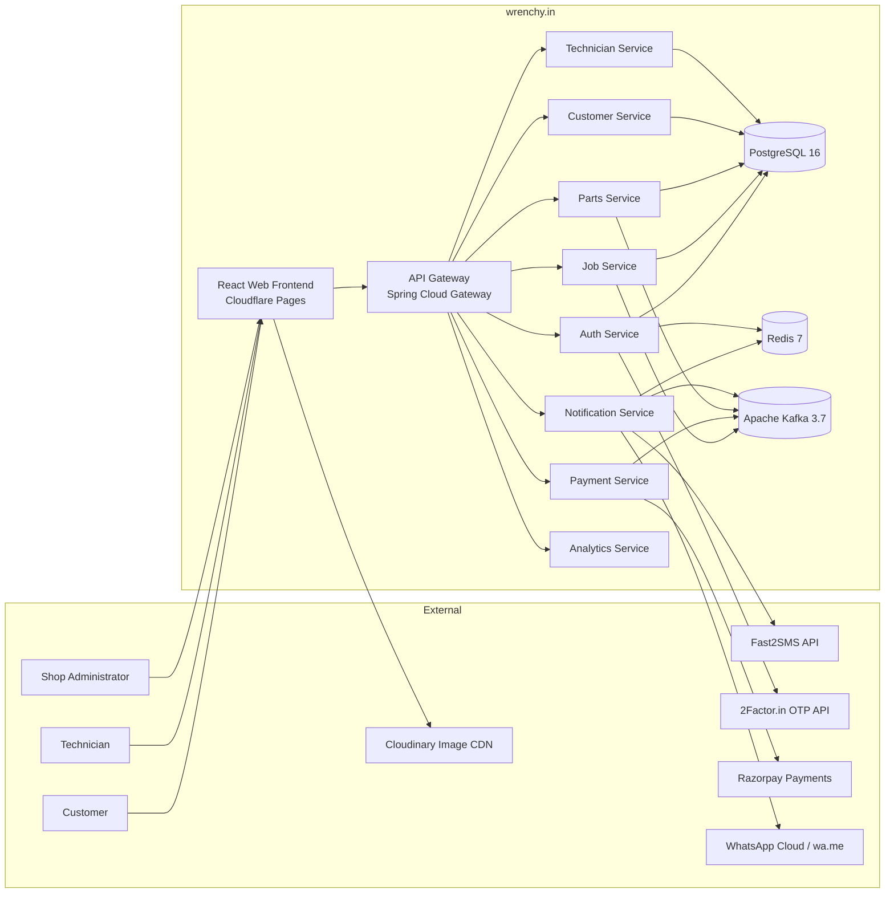
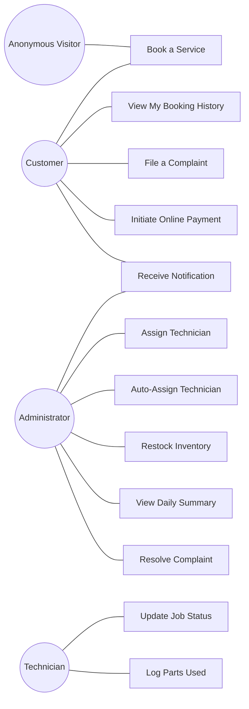

# Software Requirements Specification

## wrenchy.in — Guarantee-Backed Home Appliance Repair and Spare-Parts Platform

| Field | Value |
|---|---|
| Document Type | Software Requirements Specification (SRS) |
| Standard | IEEE 830-1998 (adapted) |
| Version | 1.0 |
| Status | Draft for review |
| Author | [ADD: Author Name] |
| Owner Entity | SK Electronics, Banda, Uttar Pradesh (operating partner) |
| Domain | Home appliance repair, spare-parts retail |
| Last Updated | [ADD: YYYY-MM-DD] |

---

## Table of Contents

1. Introduction
2. Overall Description
3. Functional Requirements
4. Non-Functional Requirements
5. External Interface Requirements
6. Other Requirements
7. Appendices

---

## 1. Introduction

### 1.1 Purpose

This Software Requirements Specification (SRS) defines the functional and non-functional requirements of **wrenchy.in**, a guarantee-backed home appliance repair and spare-parts platform that connects customers needing appliance repair with verified technicians, backed by a physical spare-parts retail and service business (SK Electronics, Banda, Uttar Pradesh, established 1991, third-generation operated).

The intended audience for this document includes:

- The software engineering team building wrenchy.in (currently a single engineer)
- The operating partner (SK Electronics) approving feature scope
- Academic evaluators reviewing the project as part of a B.Tech (Computer Science and Engineering) submission at Chandigarh University
- Future engineering, operations, and investor stakeholders evaluating the platform

### 1.2 Scope

The system shall provide the following high-level capabilities:

1. Allow customers in Banda district (and configurable service-area extensions) to book home appliance repair services through a public web interface without account creation friction.
2. Allow shop administrators and technicians to authenticate, view assigned jobs, update job status across a defined lifecycle, link spare parts to a job, and accept payment.
3. Manage a spare-parts inventory at SKU level with stock control, reorder thresholds, and consumption traceability to jobs.
4. Coordinate field technicians with skills, availability windows, and a trust score derived from completed jobs, complaints, and warranty claims.
5. Notify customers and administrators across SMS, WhatsApp, and in-app channels using an asynchronous event-driven mechanism.
6. Process online payments via Razorpay and issue invoices.
7. Capture customer complaints and warranty/guarantee claims, link them to original jobs, and route them for resolution.
8. Expose operational data for offline business intelligence integration (Apache Superset, Microsoft Power BI, or Tableau) in a future phase.

**Out of scope for version 1.0:**

- Native mobile applications for iOS or Android. The first release is a responsive web application.
- Multi-language UI beyond English with selected Hindi micro-labels.
- Multi-tenant operation. The system serves a single operating partner (SK Electronics).
- Direct integration with national appliance brand warranty portals (LG, Samsung, Whirlpool, Voltas). Warranty data is captured manually.
- Real-time technician GPS tracking on a map view. Status is event-driven (text status updates), not coordinate-streaming.

### 1.3 Definitions, Acronyms, and Abbreviations

| Term | Definition |
|---|---|
| AMC | Annual Maintenance Contract — a recurring service agreement |
| API | Application Programming Interface |
| ATS | Applicant Tracking System (irrelevant here; included for clarity if seen in code) |
| DLT | Distributed Ledger Technology registration with TRAI for transactional SMS in India |
| Guarantee | A defined post-repair window during which a recurrence of the same fault is re-serviced at zero additional charge |
| JWT | JSON Web Token (RFC 7519), the access-token format used by the platform |
| OTP | One-Time Password, used for phone-based authentication |
| REST | Representational State Transfer (API style) |
| SKU | Stock Keeping Unit, a unique identifier for an inventory item |
| SLA | Service Level Agreement |
| SRS | Software Requirements Specification |
| TRAI | Telecom Regulatory Authority of India |

### 1.4 References

- IEEE Standard 830-1998: IEEE Recommended Practice for Software Requirements Specifications
- IETF RFC 7519: JSON Web Token (JWT)
- IETF RFC 6749: OAuth 2.0 Authorization Framework
- ISO/IEC 25010:2011: Systems and Software Quality Requirements and Evaluation (used as a reference for non-functional categories)
- Spring Boot 3.3.5 Reference Documentation
- OWASP Top 10 (2021) Web Application Security Risks

### 1.5 Document Overview

Section 2 provides the overall product perspective, user classes, operating environment, and constraints. Section 3 enumerates functional requirements grouped by feature area, each requirement being uniquely identified, testable, and priority-tagged. Section 4 enumerates non-functional requirements with measurable targets. Section 5 defines external interfaces. Section 6 captures legal, compliance, and data-retention requirements. Appendices include a glossary and a high-level use case catalog.

---

## 2. Overall Description

### 2.1 Product Perspective

wrenchy.in is a new, independently developed product that augments the existing physical operations of SK Electronics. It is not a replacement for the existing cash-flow business; rather, it is a digital growth layer that uses the physical shop's existing assets — parts inventory, technician relationships, and 35 years of local trust — as a competitive moat against generic national service marketplaces.

The platform is decomposed into nine independently deployable backend microservices communicating through a synchronous REST mesh (via an API Gateway) and an asynchronous event bus (Apache Kafka). A single-page React web frontend serves customers and administrators.

The conceptual context of the system is shown in the diagram below.

### 2.2 Product Functions

The system provides the following high-level functions. Each maps to one or more functional requirements in Section 3.

- Public service booking without prior registration
- Phone-number-based one-time password (OTP) authentication
- Role-based access control distinguishing Customer, Technician, Administrator, and Owner
- Job lifecycle management across an 8-state state machine
- Manual and automatic technician assignment
- Spare-parts catalog browsing, inventory tracking, and consumption linkage to a job
- Asynchronous, multi-channel notification dispatch with retry and fallback
- Online payment collection and invoice generation
- Customer complaint capture and warranty re-service handling
- Operational metrics and reporting endpoints for downstream BI tools

### 2.3 User Classes and Characteristics

| User Class | Description | Technical Skill | Access |
|---|---|---|---|
| **Anonymous Visitor** | Any internet user visiting `wrenchy.in`. Browses the public landing page and books a service without authentication. | Low. Smartphone literacy assumed. | Public endpoints only. |
| **Customer** | A booked individual or household requiring appliance repair. Identified by phone number. Authenticates via OTP only when accessing personal history. | Low. Phone-first interaction. Hindi or English. | Public booking; OTP-authenticated personal history; complaint submission. |
| **Technician (Field Worker)** | A verified individual carrying out on-site repairs. May be hired employee of SK Electronics or freelance partner. Identified by phone, profile, skills, and a trust score. | Low to moderate. Uses a simplified mobile-web interface. | Authenticated; reads assigned jobs; updates status; logs parts consumed; uploads photos. |
| **Shop Administrator** | Operational staff (currently the shop owner — proprietor of SK Electronics — and an authorized family member). Assigns jobs, manages inventory, handles complaints, reviews payments. | Low to moderate. **[ASSUMPTION]** The primary administrator (the shop proprietor) is resistant to complex interfaces; the system must present a single dashboard summarising the day's work. | Authenticated; admin role; full operational access. |
| **Owner / Super-Administrator** | The platform owner. Same person as the lead engineer for version 1.0. Has full system access including configuration of phone routing, vendor keys, and technician onboarding. | High. | Authenticated; super-admin role. |
| **System Integrator (Future)** | A future BI engineer or analyst connecting Apache Superset, Power BI, or Tableau to the analytics endpoints. | High. | Authenticated via service token; read-only on analytics datamart. |

### 2.4 Operating Environment

| Layer | Specification |
|---|---|
| Backend Runtime | OpenJDK 21, Spring Boot 3.3.5, virtual threads enabled |
| Container Runtime | Docker 24+, Docker Compose v2 |
| Database | PostgreSQL 16 (Alpine image), single-instance for v1.0 |
| Cache and OTP Store | Redis 7 (Alpine image), single-instance |
| Message Broker | Apache Kafka 3.7, single-broker for v1.0 |
| Reverse Proxy | Caddy 2 (automatic Let's Encrypt TLS) |
| Cloud Host | **[ASSUMPTION]** Microsoft Azure Virtual Machine (B-series, 2 vCPU, 4 GB RAM) for v1.0. The reference architecture is portable to AWS EC2 + RDS + ElastiCache + MSK with minor configuration changes. |
| Frontend Runtime | Modern evergreen browsers (Chrome, Safari, Edge, Firefox, last two major versions). React 19 + Vite + Tailwind CSS. |
| Frontend Hosting | Cloudflare Pages with global CDN |
| Frontend → Backend Transport | HTTPS over TLS 1.3, JWT in Authorization header |
| Internal Service Mesh | Plain HTTP within the VM (loopback); JWT validated only at gateway |
| DNS | Cloudflare DNS (`wrenchy.in`, `api.wrenchy.in`) |

### 2.5 Design and Implementation Constraints

The following constraints shape architectural and implementation decisions for version 1.0.

- **C-01 — Single-VM deployment.** The platform shall run on a single Azure VM in v1.0 due to cost constraints (a student Azure subscription with credit cap of approximately ₹8,500). Trade-off: no horizontal scaling, no cross-zone redundancy.
- **C-02 — Java / Spring stack only.** Backend services shall be written in Java with Spring Boot. Trade-off: faster development given the engineer's skill profile; higher memory footprint per service compared to Go or Node.js.
- **C-03 — WhatsApp delivery without Cloud API in v1.0.** WhatsApp notifications shall use `wa.me` deep links and a WhatsApp Business Application installed on the shop owner's phone, not the WhatsApp Cloud API. Trade-off: zero ongoing cost and no DLT registration; manual confirmation step is acceptable at current scale (< 10 bookings per day).
- **C-04 — SMS via Fast2SMS Quick route.** Transactional SMS shall use the Fast2SMS Quick route (no DLT registration required) in v1.0. Trade-off: per-message cost is ₹0.30 and sender ID is generic; acceptable at current scale.
- **C-05 — Phone routing convention.** Two operational phone numbers are bound to distinct roles: 8960245022 is reserved for customer-facing brand contact, and 6306557517 is reserved for vendor account ownership (Fast2SMS, 2Factor, Razorpay, etc.). The system shall not transmit the vendor-account phone number to end users.
- **C-06 — Public booking without authentication.** A public booking endpoint shall accept anonymous submissions; downstream services shall trust the gateway to enforce request-rate and abuse controls. Trade-off: lower friction at the cost of slightly weaker spam defenses; mitigated by rate-limiting (NFR-SEC-04).
- **C-07 — No Kubernetes in v1.0.** Service orchestration is via Docker Compose, not Kubernetes or AWS ECS. Trade-off: simpler operations; migration path to Kubernetes is preserved by keeping services stateless and 12-factor compliant.
- **C-08 — Single-region deployment.** No disaster recovery region or backup datacenter in v1.0. Trade-off: lower cost; mitigated by daily off-VM database snapshots stored on Cloudflare R2 or Azure Blob Storage.

### 2.6 Assumptions and Dependencies

#### Assumptions

- **[ASSUMPTION]** The primary operational user (shop proprietor) will perform at most ten administrative actions per day during v1.0 due to a resistance to digital workflows. The system must therefore make every action self-evident on the dashboard, with no required navigation depth greater than two clicks.
- **[ASSUMPTION]** Customer trust in Banda is heavily local. **[INFERENCE]** Brand-level differentiation via the SK Electronics name is more valuable than a national-brand technician marketplace presentation.
- **[ASSUMPTION]** Initial customer acquisition will occur predominantly through Google Business Profile, Instagram, and word-of-mouth (WhatsApp). The system shall not depend on paid advertising for v1.0 scale.
- **[ASSUMPTION]** Network bandwidth on the customer side is adequate for a responsive web application (4G LTE minimum). Bookings on 2G/3G are best-effort.

#### Dependencies

- **D-01** Fast2SMS API for transactional SMS dispatch.
- **D-02** 2Factor.in API for OTP dispatch during phone-based authentication.
- **D-03** Razorpay payment gateway for online payments and invoices.
- **D-04** Cloudinary CDN for storage and delivery of pre- and post-repair photographs.
- **D-05** Cloudflare for DNS, frontend hosting, and edge TLS.
- **D-06** Microsoft Azure for backend compute hosting.
- **D-07** WhatsApp Business Application on the shop proprietor's mobile device for manual greeting and away-message responses.

---

## 3. Functional Requirements

Functional requirements are numbered with the convention `FR-<AREA>-<NN>`. Each requirement carries a priority of High (H), Medium (M), or Low (L). H = required for v1.0 launch; M = required within 90 days of launch; L = nice-to-have, deferred.

### 3.1 Authentication and Identity (FR-AUTH)

| ID | Priority | Description |
|---|---|---|
| FR-AUTH-01 | H | The system shall accept a 10-digit Indian mobile phone number as the sole identifier for authentication. International numbers are out of scope for v1.0. |
| FR-AUTH-02 | H | On a request for OTP issuance, the system shall generate a 6-digit numeric OTP, store it in Redis with a TTL of 5 minutes, and dispatch it via the 2Factor.in API. |
| FR-AUTH-03 | H | The system shall limit OTP issuance to a maximum of 3 requests per phone number per 15-minute window and 8 per phone number per 24-hour window. |
| FR-AUTH-04 | H | On successful OTP verification, the system shall issue a JWT access token with a 30-minute expiry and a refresh token with a 30-day expiry. |
| FR-AUTH-05 | H | The system shall sign JWTs using HMAC-SHA256 with a shared secret of at least 32 bytes loaded from an externalized environment variable. |
| FR-AUTH-06 | H | The system shall expose `/api/v1/auth/refresh` to exchange a valid, unrevoked refresh token for a new access token without requiring the user to re-authenticate. |
| FR-AUTH-07 | M | The system shall expose `/api/v1/auth/logout` to revoke a refresh token by adding it to a Redis-backed blacklist with TTL equal to the remaining token lifetime. |
| FR-AUTH-08 | H | The JWT payload shall include `sub` (user UUID), `role` (one of `CUSTOMER`, `TECHNICIAN`, `ADMIN`, `OWNER`), `iat`, and `exp`. |
| FR-AUTH-09 | H | The API Gateway shall validate every non-whitelisted request's JWT, reject unauthenticated requests with HTTP 401, and inject `X-User-Id` and `X-User-Role` headers on validated requests. |
| FR-AUTH-10 | H | Whitelisted (public) paths shall be configurable centrally at the gateway and shall include at minimum: `/api/v1/auth/otp/send`, `/api/v1/auth/otp/verify`, `/api/v1/auth/refresh`, `/public`, `/actuator/health`. |

### 3.2 Customer Profile (FR-CUST)

| ID | Priority | Description |
|---|---|---|
| FR-CUST-01 | H | The system shall persist a customer record on first booking, keyed by phone number and including `name`, `phone`, `address`, `landmark`, `created_at`. |
| FR-CUST-02 | H | The system shall allow an authenticated customer to view their booking history sorted by `created_at` descending. |
| FR-CUST-03 | M | The system shall consolidate multiple bookings sharing the same phone number under a single customer profile, even when the customer name differs across bookings (last name wins). |
| FR-CUST-04 | M | The system shall expose `/api/v1/customers/by-phone/{phone}` (admin-only) returning the consolidated profile and the last 50 bookings. |
| FR-CUST-05 | L | The system shall flag customers as `AMC_OPPORTUNITY` and emit a Kafka event when a single customer has placed 3 or more service bookings within a rolling 12-month window. |

### 3.3 Booking Lifecycle (FR-JOB)

| ID | Priority | Description |
|---|---|---|
| FR-JOB-01 | H | The system shall expose a public booking endpoint at `POST /public` accepting JSON `{ name, phone, address, appliance, problem, schedule }` without authentication. |
| FR-JOB-02 | H | On accepting a public booking, the system shall persist a `Job` row with status `REQUESTED`, assign a 6-character alphanumeric reference ID, and emit a `job.created` Kafka event. |
| FR-JOB-03 | H | The system shall enforce the following job state machine: `REQUESTED → ASSIGNED → IN_TRANSIT → AT_CUSTOMER → IN_PROGRESS → (COMPLETED \| PARTS_NEEDED → IN_PROGRESS) \| CANCELLED`. Transitions outside this machine shall return HTTP 409. |
| FR-JOB-04 | H | The system shall record each status transition as an immutable `JobStatusEvent` row with `from_status`, `to_status`, `actor_user_id`, `actor_role`, `reason`, `created_at`. |
| FR-JOB-05 | H | The system shall expose `POST /api/v1/jobs/{id}/assign` for an administrator to assign a primary technician and an optional assistant technician. |
| FR-JOB-06 | M | The system shall expose `POST /api/v1/jobs/{id}/auto-assign` which selects the highest-trust-score technician available in the job's service area with the required skill tag, and assigns them. Tie-breaks by least-recently-assigned. |
| FR-JOB-07 | H | The system shall expose `GET /api/v1/jobs` with optional query parameters `status`, `customerPhone`, `technicianId`, `from`, `to`, `page`, `size`. |
| FR-JOB-08 | H | The system shall expose `GET /api/v1/jobs/my` for an authenticated technician to retrieve all jobs currently assigned to them. |
| FR-JOB-09 | M | The system shall accept upload of a pre-repair photograph and a post-repair photograph per job, stored on Cloudinary with the secure URL persisted on the job. |
| FR-JOB-10 | M | The system shall calculate and persist `total_amount` per job as the sum of `service_charge` plus `sum(parts.unit_price * parts.quantity)` at the moment the job transitions to `COMPLETED`. |
| FR-JOB-11 | M | The system shall mark a completed job's `guarantee_expires_at` as `completed_at + guarantee_period_days`, where `guarantee_period_days` is configurable per appliance category (default 30). |

### 3.4 Parts Catalog and Inventory (FR-PARTS)

| ID | Priority | Description |
|---|---|---|
| FR-PARTS-01 | H | The system shall maintain a parts catalog with at minimum: `sku`, `name`, `category`, `brand`, `model_compatibility[]`, `unit_price`, `current_stock`, `reorder_threshold`, `supplier_id`. |
| FR-PARTS-02 | H | The system shall expose `GET /api/v1/parts` with full-text search across `name`, `sku`, and `brand`, and filter by `category`. |
| FR-PARTS-03 | H | The system shall link parts consumption to a job via `JobPartUsage(job_id, sku, quantity, unit_price_at_use)` rows. |
| FR-PARTS-04 | H | On a `JobPartUsage` insert, the system shall atomically decrement `Part.current_stock` by `quantity` within the same database transaction. |
| FR-PARTS-05 | H | The system shall emit a Kafka event `inventory.reorder-alert` when, after a stock decrement, `current_stock` falls at or below `reorder_threshold`. |
| FR-PARTS-06 | M | The system shall reject part consumption when `current_stock < quantity` with HTTP 409 and message `INSUFFICIENT_STOCK`. |
| FR-PARTS-07 | M | The system shall expose `POST /api/v1/parts/{sku}/restock` (admin-only) to increment stock and persist a `StockMovement` row. |
| FR-PARTS-08 | L | The system shall expose `GET /api/v1/parts/{sku}/movements` returning the chronological stock movement ledger for the SKU. |

### 3.5 Technician Management (FR-TECH)

| ID | Priority | Description |
|---|---|---|
| FR-TECH-01 | H | The system shall maintain a technician profile with `id`, `name`, `phone`, `skills[]`, `service_areas[]`, `is_active`, `is_freelance`, `trust_score`, `joined_at`. |
| FR-TECH-02 | H | The system shall maintain a weekly availability schedule per technician (`day_of_week`, `start_time`, `end_time`). |
| FR-TECH-03 | M | The system shall compute `trust_score` as a weighted function of: completed-job count (positive), customer-rating average (positive), complaint count (negative), no-show count (negative), warranty-recurrence count (strongly negative). Recomputed on each completed job and on each complaint. |
| FR-TECH-04 | H | The system shall expose `GET /api/v1/technicians` (admin-only) returning active technicians sorted by `trust_score` descending. |
| FR-TECH-05 | M | The system shall expose `PATCH /api/v1/technicians/{id}/availability` for a technician to update their own availability schedule. |
| FR-TECH-06 | L | The system shall flag a technician with `trust_score < 50` for administrator review. |

### 3.6 Complaint and Guarantee Handling (FR-COMP)

| ID | Priority | Description |
|---|---|---|
| FR-COMP-01 | H | The system shall expose `POST /api/v1/jobs/{id}/complaint` for a customer to register a complaint against a completed job, including `category` (one of: `RECURRENCE`, `BEHAVIOR`, `PRICING`, `PUNCTUALITY`, `OTHER`) and `description`. |
| FR-COMP-02 | H | When a complaint of category `RECURRENCE` is filed within the job's `guarantee_expires_at` window, the system shall create a new linked job with `parent_job_id` set and `is_guarantee_service = true` and `service_charge = 0`. |
| FR-COMP-03 | H | The system shall decrement the assigned technician's `trust_score` by a configurable amount on each `RECURRENCE` or `BEHAVIOR` complaint. |
| FR-COMP-04 | M | The system shall expose `GET /api/v1/complaints?status={OPEN\|RESOLVED}` (admin-only). |
| FR-COMP-05 | M | The system shall require an administrator to resolve each complaint with a free-text resolution note before the complaint transitions to `RESOLVED`. |

### 3.7 Notification Dispatch (FR-NOTIF)

| ID | Priority | Description |
|---|---|---|
| FR-NOTIF-01 | H | The system shall consume `job.created` Kafka events and dispatch a notification to all phone numbers configured in `ADMIN_ALERT_PHONES` via SMS. |
| FR-NOTIF-02 | H | The system shall consume `job.status.changed` Kafka events and dispatch a status-update notification to the customer's phone on transitions to `ASSIGNED`, `IN_TRANSIT`, `COMPLETED`, and `CANCELLED`. |
| FR-NOTIF-03 | H | The system shall consume `payment.received` Kafka events and dispatch a payment confirmation to the customer. |
| FR-NOTIF-04 | M | The system shall attempt delivery in the order WhatsApp → SMS, falling back to SMS only when WhatsApp returns a 4xx or 5xx response. |
| FR-NOTIF-05 | M | The system shall persist a `NotificationDispatchLog` row per attempt with `channel`, `recipient`, `template`, `vendor_response_code`, `succeeded`, `attempted_at`. |
| FR-NOTIF-06 | H | The system shall suppress duplicate notifications by checking a Redis key `notif:dedup:{event_id}:{channel}:{recipient}` with TTL 24 hours. |
| FR-NOTIF-07 | M | The system shall enforce a per-recipient SMS cooldown of 24 hours for non-critical notifications (configurable via `serviceos.notification.sms-cooldown-hours`). |
| FR-NOTIF-08 | L | The system shall retry transient vendor failures (HTTP 5xx) up to 3 times with exponential backoff (1s, 4s, 16s). |

### 3.8 Payment and Invoicing (FR-PAY)

| ID | Priority | Description |
|---|---|---|
| FR-PAY-01 | H | The system shall expose `POST /api/v1/payments/{job_id}/initiate` returning a Razorpay order ID for client-side checkout. |
| FR-PAY-02 | H | The system shall expose a public webhook `POST /api/v1/payments/webhook/razorpay` that verifies the `X-Razorpay-Signature` header against the configured webhook secret. |
| FR-PAY-03 | H | On a verified `payment.captured` webhook event, the system shall persist a `Payment` row, mark the linked job as `is_paid = true`, and emit a `payment.received` Kafka event. |
| FR-PAY-04 | M | The system shall generate a PDF invoice on transition to `COMPLETED + is_paid = true`, store it on Cloudinary, and persist its URL on the job. |
| FR-PAY-05 | M | The system shall support a `CASH` payment mode set by an administrator on the job, marking `is_paid = true` without an associated Razorpay payment. |
| FR-PAY-06 | L | The system shall expose `GET /api/v1/payments?from=&to=` returning a reconciliation list of all payments in the window. |

### 3.9 Analytics (FR-ANALYT)

| ID | Priority | Description |
|---|---|---|
| FR-ANALYT-01 | M | The system shall maintain a read-only `analytics_*` schema in PostgreSQL with materialised views denormalising `Job`, `Payment`, `Complaint`, `Part`, and `Technician` data for BI consumption. |
| FR-ANALYT-02 | L | The system shall refresh analytics materialised views nightly at 03:00 IST. |
| FR-ANALYT-03 | L | The system shall expose `GET /api/v1/analytics/dashboards/daily` for a JSON summary of jobs created, jobs completed, complaints, and revenue for the previous business day. |
| FR-ANALYT-04 | L | The analytics schema shall be accessible via a read-only PostgreSQL role to external BI tools (Tableau, Power BI, Apache Superset). |

### 3.10 API Gateway (FR-GATE)

| ID | Priority | Description |
|---|---|---|
| FR-GATE-01 | H | The gateway shall route requests by path prefix to the corresponding downstream service. |
| FR-GATE-02 | H | The gateway shall terminate client TLS at Caddy and forward plain HTTP within the loopback to downstream services. |
| FR-GATE-03 | H | The gateway shall enforce CORS, accepting only origins listed in `CORS_ALLOWED_ORIGINS`. |
| FR-GATE-04 | M | The gateway shall apply per-IP rate-limiting of 60 requests per minute on public booking endpoints and 600 requests per minute on authenticated endpoints. |
| FR-GATE-05 | H | The gateway shall pass through OPTIONS preflight requests without authentication. |
| FR-GATE-06 | M | The gateway shall expose `/actuator/health` returning `200 OK` only when all downstream services report `UP`. |

---

## 4. Non-Functional Requirements

Each requirement is uniquely identified, individually testable, and carries a measurable target. Targets are calibrated to a single-VM deployment serving a single shop at an expected steady-state of up to 50 bookings per day in v1.0.

### 4.1 Performance (NFR-PERF)

| ID | Target | Rationale |
|---|---|---|
| NFR-PERF-01 | p95 API latency under load shall be ≤ 300 ms for read endpoints and ≤ 500 ms for write endpoints, measured at the gateway over a one-hour window. | Acceptable perceived latency on mobile networks in tier-3 India. |
| NFR-PERF-02 | The public booking endpoint shall sustain at least 20 concurrent submissions without error. | Worst-case marketing burst. |
| NFR-PERF-03 | Database queries on the `jobs` table shall complete in under 50 ms p95 for indexed lookups by `id`, `customer_phone`, `status`, and `assigned_technician_id`. | Index strategy must support primary access patterns. |
| NFR-PERF-04 | Kafka event end-to-end latency from publish to consumer commit shall be ≤ 2 seconds p95. | Notifications must appear "near-real-time" to administrators. |
| NFR-PERF-05 | Frontend Largest Contentful Paint (LCP) shall be ≤ 2.5 seconds on a simulated 4G connection, measured via Lighthouse. | Web Core Vital threshold for "Good". |

### 4.2 Scalability (NFR-SCAL)

| ID | Target | Rationale |
|---|---|---|
| NFR-SCAL-01 | The architecture shall support horizontal scaling of stateless backend services without code changes. | Achieved by 12-factor compliance, JWT-only sessions, externalised configuration. |
| NFR-SCAL-02 | The system shall support a 5× growth in daily bookings (from 50 to 250) by vertical scaling of the VM (4 vCPU, 8 GB RAM) without architectural change. | Sufficient runway through year one. |
| NFR-SCAL-03 | PostgreSQL shall be replaceable with a managed service (Azure Database for PostgreSQL, AWS RDS) via configuration-only changes. | Avoids vendor lock-in. |
| NFR-SCAL-04 | The notification service shall scale to 1,000 messages per minute by adding consumer instances within the same Kafka consumer group. | Capacity headroom for a future bulk-marketing feature. |

### 4.3 Security (NFR-SEC)

| ID | Target | Rationale |
|---|---|---|
| NFR-SEC-01 | All traffic between client and gateway shall use TLS 1.2 or higher. | Industry baseline. |
| NFR-SEC-02 | Passwords are not stored; authentication is OTP-based. JWTs are short-lived (≤ 30 minutes). | Reduces credential-theft impact. |
| NFR-SEC-03 | All secrets shall be loaded from environment variables, never committed to source. Repository scans shall fail CI if a secret pattern is detected. | OWASP A07: Identification and Authentication Failures. |
| NFR-SEC-04 | The public booking endpoint shall rate-limit to 5 submissions per phone number per hour and 100 per IP per hour. | Spam and abuse defense. |
| NFR-SEC-05 | All database writes shall use parameterised queries (Spring Data JPA / Hibernate). Native SQL with string interpolation is prohibited. | OWASP A03: Injection. |
| NFR-SEC-06 | OWASP Dependency-Check shall be executed in CI and shall fail the build on any dependency with a CVSS ≥ 7.0. | OWASP A06: Vulnerable and Outdated Components. |
| NFR-SEC-07 | The `Strict-Transport-Security`, `X-Content-Type-Options`, and `Referrer-Policy` security headers shall be present on all responses. | OWASP A05: Security Misconfiguration. |
| NFR-SEC-08 | Personal customer data (phone, address) shall be encrypted at rest using PostgreSQL Transparent Data Encryption or disk-level encryption on the VM. | Reasonable data-protection posture. |

### 4.4 Availability (NFR-AVAIL)

| ID | Target | Rationale |
|---|---|---|
| NFR-AVAIL-01 | The system shall target 99.0% monthly uptime in v1.0 (≤ 7.2 hours downtime/month). | Single-VM realistic ceiling. |
| NFR-AVAIL-02 | All backend services shall be managed by `systemd` with automatic restart on failure (`Restart=on-failure`, `RestartSec=10`). | Resilience against transient process death. |
| NFR-AVAIL-03 | A full PostgreSQL backup shall be taken nightly and stored off-VM (Azure Blob Storage or Cloudflare R2) with 30-day retention. | Disaster recovery prerequisite. |
| NFR-AVAIL-04 | Recovery Time Objective (RTO) ≤ 4 hours; Recovery Point Objective (RPO) ≤ 24 hours. | Acceptable at v1.0 scale. |
| NFR-AVAIL-05 | The frontend shall remain reachable via Cloudflare Pages independent of backend availability, displaying a clear "Service temporarily unavailable" notice if the backend is down. | Avoids "site is down" perception during backend incidents. |

### 4.5 Reliability (NFR-REL)

| ID | Target | Rationale |
|---|---|---|
| NFR-REL-01 | The Kafka consumer shall use at-least-once delivery with idempotent processing keyed on event ID. | Duplicate notifications during retries are not acceptable. |
| NFR-REL-02 | Notification dispatch failures shall be retried with exponential backoff to a maximum of 3 attempts before being marked failed. | Bounded retry. |
| NFR-REL-03 | All database writes that span more than one table shall be enclosed in a single transaction. | Avoids partial writes. |
| NFR-REL-04 | The job state machine shall reject all illegal transitions at the service layer, not only at the controller. | Defense in depth. |

### 4.6 Maintainability (NFR-MAINT)

| ID | Target | Rationale |
|---|---|---|
| NFR-MAINT-01 | Source code shall follow Google Java Style as enforced by `spotless-maven-plugin` in CI. | Consistent style. |
| NFR-MAINT-02 | Unit test coverage shall be ≥ 60% for service-layer classes and 100% for the job state machine. | Critical path full-coverage; rest pragmatic. |
| NFR-MAINT-03 | Each microservice shall be independently buildable and deployable. | Microservice tenet. |
| NFR-MAINT-04 | Database schema changes shall be managed via Flyway migrations versioned in the service's source tree. | Reproducible schema evolution. |
| NFR-MAINT-05 | API contract changes shall follow semantic versioning of the `/api/v1` URL prefix; breaking changes require `/api/v2`. | Backward compatibility for clients. |

### 4.7 Usability (NFR-USE)

| ID | Target | Rationale |
|---|---|---|
| NFR-USE-01 | A new customer shall complete a booking in ≤ 90 seconds on a smartphone, measured from landing on `wrenchy.in` to receipt of the success screen. | Bookings drop off sharply past 2 minutes. |
| NFR-USE-02 | The administrator dashboard shall surface all jobs requiring action above the fold without scrolling on a 1366 × 768 display. | Aligns with the assumption that the primary administrator is resistant to navigation. |
| NFR-USE-03 | All customer-facing screens shall be operable in landscape and portrait orientation on a 360 px-wide viewport. | Tier-3 smartphone reality. |
| NFR-USE-04 | Critical labels (booking confirmation, status updates) shall be available in both English and Hindi (Devanagari). | Regional accessibility. |

### 4.8 Observability (NFR-OBSERV)

| ID | Target | Rationale |
|---|---|---|
| NFR-OBSERV-01 | Each backend service shall expose `/actuator/health`, `/actuator/info`, and `/actuator/metrics`. | Spring Boot Actuator baseline. |
| NFR-OBSERV-02 | Each backend service shall produce structured JSON logs to STDOUT with at minimum: timestamp, level, logger, message, traceId, spanId. | Aggregation-friendly. |
| NFR-OBSERV-03 | Every inbound request shall be tagged with a `X-Request-Id` header (UUIDv4); the gateway shall generate it if absent and propagate it downstream. | Cross-service correlation. |
| NFR-OBSERV-04 | The system shall emit a Prometheus-compatible metrics endpoint per service for future integration with Grafana or Azure Monitor. | Future-proofs observability. |

---

## 5. External Interface Requirements

### 5.1 User Interfaces

- **Customer Web Interface (Public).** Responsive single-page application served from `https://wrenchy.in`. Primary screens: Landing, Book Service (3-step form), Booking Confirmation, Track by Phone (OTP-gated), Complaint Form.
- **Administrator Web Interface.** Responsive single-page application served from `https://wrenchy.in/admin`. Primary screens: Dashboard (today's jobs by status column, Kanban-style), Job Detail, Parts Inventory, Technician Roster, Complaints, Daily Summary.
- **Technician Web Interface.** Mobile-first single-page application served from `https://wrenchy.in/tech`. Primary screens: My Jobs (list), Job Detail (with status-change buttons, parts log, photo upload).

### 5.2 Hardware Interfaces

No direct hardware interfaces in v1.0. Future phases may integrate barcode scanners for parts intake.

### 5.3 Software Interfaces

| Interface | Protocol | Purpose |
|---|---|---|
| Fast2SMS API | HTTPS / JSON | SMS dispatch |
| 2Factor.in API | HTTPS / JSON | OTP dispatch |
| Razorpay API | HTTPS / JSON, HMAC-signed webhooks | Payments |
| Razorpay Webhook | HTTPS / JSON, HMAC-SHA256 signature | Payment confirmation |
| Cloudinary API | HTTPS / multipart, signed upload | Image storage |
| WhatsApp Business Application (Android) | Phone-side, manual | Greeting and away messages |
| `wa.me` Deep Link | HTTPS redirect | Client-side WhatsApp open |

### 5.4 Communication Interfaces

- **Client ↔ Frontend:** HTTPS over TLS 1.3, HTTP/2 enabled.
- **Frontend ↔ Gateway:** HTTPS, JWT in `Authorization: Bearer <token>` header.
- **Gateway ↔ Services:** Plain HTTP within the VM loopback. **[INFERENCE]** Acceptable at single-VM scale; will be replaced with mTLS or service mesh on multi-node deployment.
- **Services ↔ PostgreSQL:** JDBC over loopback TCP; SSL disabled in v1.0 (loopback).
- **Services ↔ Redis:** Native protocol over loopback TCP.
- **Services ↔ Kafka:** Native Kafka protocol over loopback TCP.

---

## 6. Other Requirements

### 6.1 Legal and Compliance

- **L-01** — The platform shall display a Privacy Policy and Terms of Service accessible from the landing-page footer before collecting any personal data.
- **L-02** — Personal data collected shall be limited to phone number, name, address, and appliance information necessary for service delivery. No marketing-only data collection.
- **L-03** — The platform shall comply with the Information Technology Act, 2000 and the Digital Personal Data Protection Act, 2023 (DPDP Act) of India, including the user's right to data deletion.
- **L-04** — Transactional SMS via Fast2SMS Quick route does not require DLT (TRAI) registration in v1.0. **[ASSUMPTION]** DLT registration will be performed when daily SMS volume exceeds 1,000 or when a dedicated sender ID is required.
- **L-05** — Invoices shall include the operating partner's GSTIN if and when a GST registration is obtained by SK Electronics.

### 6.2 Data Retention

| Data Class | Retention | Justification |
|---|---|---|
| Customer profile | Lifetime of account; deleted on user request within 30 days | DPDP compliance |
| Job records | 7 years | Warranty disputes and tax records |
| Job status events | 7 years | Audit trail |
| Notification logs | 180 days | Operational debugging only |
| OTP records (Redis) | 5 minutes (TTL) | Authentication only |
| Refresh tokens | Until expiry or explicit revocation | Session continuity |
| Payment records | 7 years | Tax and reconciliation |
| Parts stock movements | 7 years | Inventory audit |
| Cloudinary photos | 5 years | Warranty and dispute evidence |

### 6.3 Internationalisation

- The system shall support English as the primary UI language.
- The system shall support Hindi (Devanagari) micro-labels alongside English on customer-facing screens.
- No other Indian language is supported in v1.0.

### 6.4 Accessibility

- The customer-facing web interface shall conform to WCAG 2.1 Level AA for colour contrast, keyboard navigation, and form labels.

---

## 7. Appendices

### Appendix A — Glossary

See Section 1.3.

### Appendix B — High-Level Use Case Catalog

| UC ID | Name | Primary Actor | Brief |
|---|---|---|---|
| UC-01 | Book a Service | Anonymous Visitor / Customer | Submit a repair request without prior registration. |
| UC-02 | View My Booking History | Customer | Authenticate via OTP and view past and present bookings. |
| UC-03 | File a Complaint | Customer | Register a complaint against a completed job. |
| UC-04 | Assign Technician | Administrator | Assign a primary technician (and optional assistant) to a job. |
| UC-05 | Auto-Assign Technician | Administrator | Let the system pick the best-fit technician by trust score and availability. |
| UC-06 | Update Job Status | Technician | Move a job through its state machine. |
| UC-07 | Log Parts Used | Technician | Record SKUs consumed during a job. |
| UC-08 | Restock Inventory | Administrator | Add stock for a SKU. |
| UC-09 | Initiate Online Payment | Customer | Pay via Razorpay checkout. |
| UC-10 | Receive Notification | Customer / Administrator | Receive SMS or WhatsApp updates on job state changes. |
| UC-11 | View Daily Summary | Administrator / Owner | See yesterday's jobs, revenue, complaints, and reorder alerts. |
| UC-12 | Resolve Complaint | Administrator | Add resolution note and close a complaint. |

### Appendix C — Use Case Diagram (Customer-Centric)

### Appendix D — Document Change Log

| Version | Date | Author | Change Summary |
|---|---|---|---|
| 1.0 | [ADD: YYYY-MM-DD] | [ADD: Author] | Initial draft. |

---

*End of document.*
