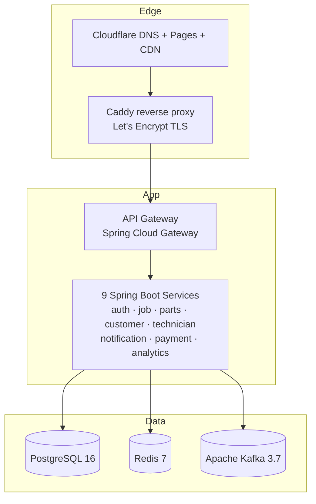
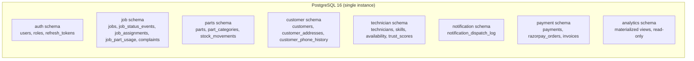
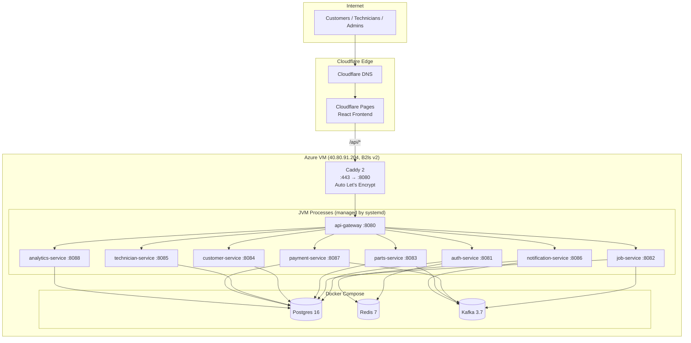
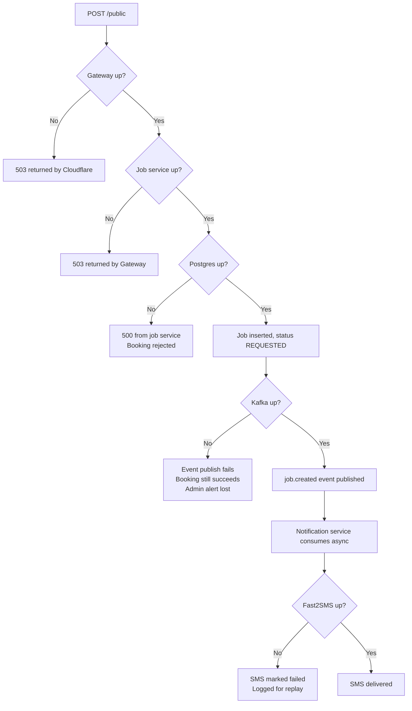
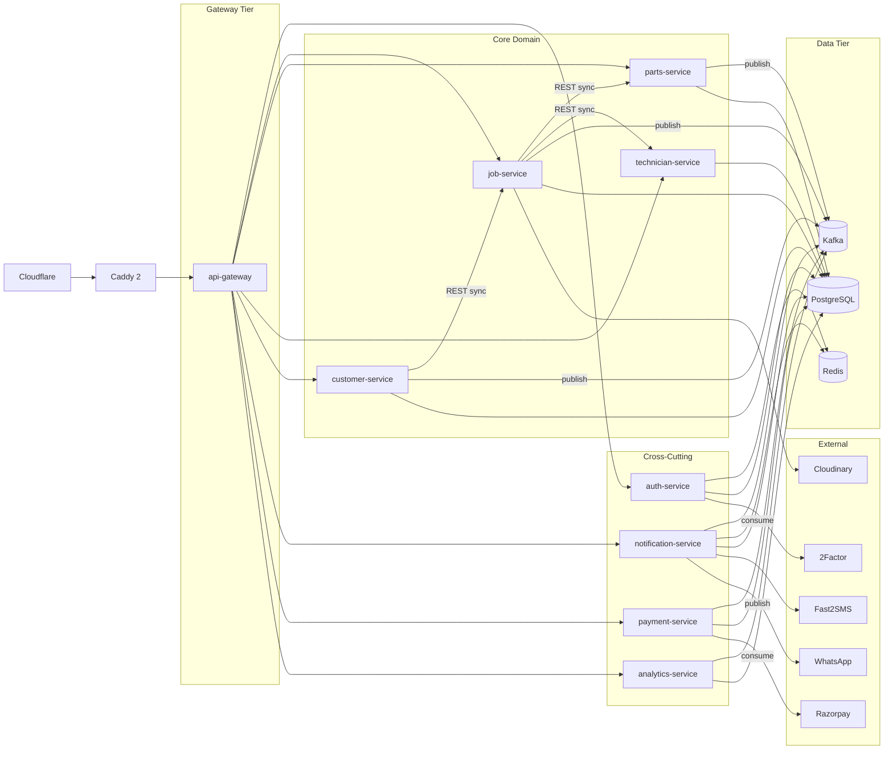
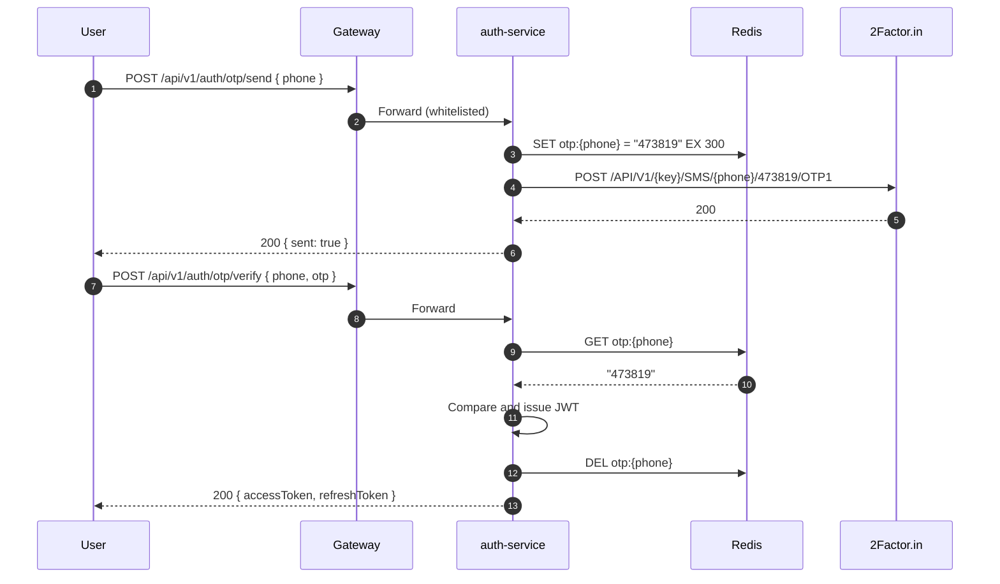
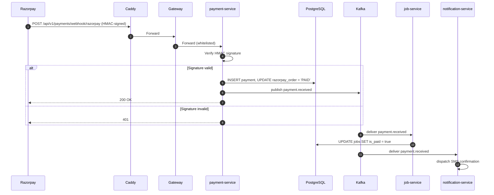
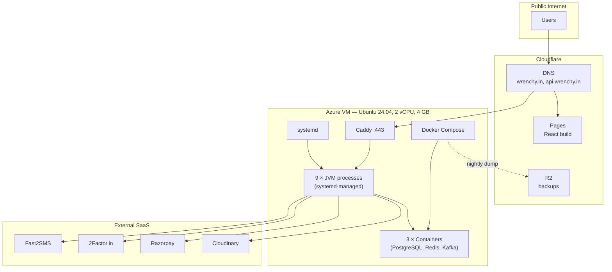

# System Design and Architecture

## wrenchy.in — Guarantee-Backed Home Appliance Repair and Spare-Parts Platform

| Field | Value |
|---|---|
| Document Type | System Design / Architecture Document |
| Companion To | SRS v1.0 (`docs/SRS.md`) |
| Version | 1.0 |
| Status | Draft for review |
| Author | [ADD: Author Name] |
| Last Updated | [ADD: YYYY-MM-DD] |

---

## Table of Contents

1. Introduction
2. Architecture Overview
3. Service Breakdown
4. Service Communication
5. Data Management
6. API Gateway and Authentication
7. Cloud Deployment Topology
8. Scalability and Fault Tolerance
9. Key Diagrams
10. Future Considerations
11. Explicit Anti-Goals (What This Design Rejects)
12. Glossary and References

---

## 1. Introduction

### 1.1 Purpose

This document describes the system architecture of wrenchy.in: the chosen style, the service decomposition, the data layout, the communication patterns, the deployment topology, and the scalability and fault-tolerance strategy. Every significant decision is followed by a one-line justification (the **WHY**) and a one-line trade-off (the **COST**). This is the document a new engineer would read after the SRS to understand how the system actually fits together.

### 1.2 Scope and Audience

The document is written for two audiences in parallel.

- **University evaluator** — assessing whether architectural decisions are defensible at the depth expected of a final-year B.Tech (CSE) project.
- **Working engineer** — joining the project tomorrow, or reviewing it before deciding to invest, partner, or contribute.

Anything implementation-level not relevant to either audience is deliberately excluded.

### 1.3 Relationship to the SRS

The SRS defines **what** the system does. This document defines **how** the system is built. Functional requirements (`FR-*`) and non-functional requirements (`NFR-*`) in the SRS drive the choices documented here; cross-references are noted where relevant.

### 1.4 Services and Entities Confirmed From the SRS

The system comprises nine independently deployable backend services and one frontend application:

| Service | Repository Module | Spring Boot Type |
|---|---|---|
| `api-gateway` | Gateway | WebFlux (Spring Cloud Gateway) |
| `auth-service` | Auth | Web MVC |
| `job-service` | Booking and lifecycle | Web MVC |
| `parts-service` | Catalog and inventory | Web MVC |
| `customer-service` | Customer profile | Web MVC |
| `technician-service` | Technician profile and trust | Web MVC |
| `notification-service` | Multi-channel dispatch | Web MVC, Kafka consumer |
| `payment-service` | Razorpay integration | Web MVC |
| `analytics-service` | Reporting and BI scaffold | Web MVC |

Primary entities (logical view): `Customer`, `Job`, `JobStatusEvent`, `JobAssignment`, `JobPartUsage`, `Complaint`, `Technician`, `TechnicianSkill`, `TechnicianAvailability`, `Part`, `StockMovement`, `Payment`, `Invoice`, `Notification`, `NotificationDispatchLog`, `RefreshToken`, `OtpRecord` (Redis).

---

## 2. Architecture Overview

### 2.1 Chosen Architectural Style: Microservices

**Decision.** The system is decomposed into nine independently deployable Spring Boot services, communicating synchronously over REST through an API Gateway and asynchronously over Apache Kafka.

**WHY.** Three reasons, ranked by weight.

1. **Bounded contexts are genuinely distinct.** Auth, inventory, technician trust, and payment do not share data ownership or release cadence. They evolve at different speeds.
2. **Operational learning for the engineer.** The project is also a learning vehicle for a final-year CSE student. Building and operating a real microservice mesh in production teaches gateway design, event-driven patterns, and idempotency in a way no tutorial can.
3. **Future scale plausibility.** The operating partner (SK Electronics) plans expansion to neighbouring towns. A modular monolith refactor at month 18 is materially harder than starting modular.

**COST.**

- Nine services on a single 2 vCPU / 4 GB VM consume more RAM than a single monolith (each JVM holds ~150 MB heap minimum). Production runs near the memory ceiling and required swap provisioning.
- Each new feature touches at least two services on average, increasing PR overhead.
- Distributed tracing, request correlation, and idempotency now require engineering effort that a monolith would handle implicitly.

**Honest counter-position: a modular monolith would arguably be simpler at scale 0–50 bookings/day.** A single Spring Boot module with packages mirroring the same nine bounded contexts would serve current load with one-third the memory and one-fifth the operational overhead. The decision to go microservices was deliberate and weighted toward learning and future-proofing, not load.

### 2.2 Architectural Principles Applied

- **12-Factor App.** Configuration is externalised to environment variables (`/opt/serviceos/.env`); the build produces the same artifact for any environment; logs go to STDOUT; services are stateless. *Implemented in v1.0.*
- **Statelessness at the service layer.** No service holds session state. JWTs and Redis-backed OTPs are the only session-like constructs; both are stateless from the service's perspective. *Implemented.*
- **Single Responsibility per service.** Each service owns one business capability. *Implemented, with the caveat that complaint-handling currently lives inside the job service — see Section 10.3.*
- **Asynchronous by default for side-effects.** Notifications, BI feeds, and AMC-opportunity calculations are Kafka-driven so booking latency is bounded. *Implemented.*
- **Explicit failure modes.** Every external dependency (Fast2SMS, 2Factor, Razorpay, Cloudinary, WhatsApp) has a documented fallback or graceful degradation. *Implemented for SMS and WhatsApp; pending for Razorpay.*
- **Smart endpoints, dumb pipes.** Kafka transports JSON events; routing, retries, and dead-letter logic live in service code, not in broker configuration. *Implemented.*

### 2.3 Layered View



---

## 3. Service Breakdown

For each service the breakdown lists **responsibility**, **owned data**, **key APIs**, and a **boundary justification**.

### 3.1 `api-gateway`

- **Responsibility.** Single ingress for the public internet. Terminates plain HTTP from Caddy. Validates JWTs. Injects `X-User-Id` and `X-User-Role` headers downstream. Enforces CORS. Routes by path prefix.
- **Owned Data.** None. Stateless.
- **Key APIs.** All public-facing paths under `/api/v1/**` and `/public/**` — gateway is the routing surface, not an origin.
- **Boundary Justification.** The gateway is the only service that speaks to the public. Removing the gateway from each downstream service eliminates ~200 lines of duplicated auth and CORS code per service.

### 3.2 `auth-service`

- **Responsibility.** Phone-based OTP issuance and verification. JWT issuance, refresh-token rotation, and revocation.
- **Owned Data.** `User`, `Role`, `RefreshToken`. `OtpRecord` lives in Redis with a TTL.
- **Key APIs.**
  - `POST /api/v1/auth/otp/send`
  - `POST /api/v1/auth/otp/verify`
  - `POST /api/v1/auth/refresh`
  - `POST /api/v1/auth/logout`
- **Boundary Justification.** Identity is its own bounded context. Every other service consumes the JWT but never issues one. This separation also allows the auth service to be replaced (e.g., with AWS Cognito or Auth0) without touching downstream code.

### 3.3 `job-service`

- **Responsibility.** The booking lifecycle. State machine enforcement. Customer-job linkage. Public booking endpoint. Complaint capture (until split out per Section 10.3).
- **Owned Data.** `Job`, `JobStatusEvent`, `JobAssignment`, `JobPartUsage` (link table to parts; see boundary note), `Complaint`.
- **Key APIs.**
  - `POST /public` — anonymous booking
  - `POST /api/v1/jobs` — admin-created booking
  - `GET /api/v1/jobs` — list with filters
  - `GET /api/v1/jobs/{id}`
  - `PUT /api/v1/jobs/{id}/status` — state transition
  - `POST /api/v1/jobs/{id}/assign`
  - `POST /api/v1/jobs/{id}/auto-assign`
  - `POST /api/v1/jobs/{id}/complaint`
- **Boundary Justification.** The booking lifecycle is the heart of the business. Isolating it lets the team change parts logic, technician logic, or payment logic without touching the state machine.

### 3.4 `parts-service`

- **Responsibility.** SKU catalog. Stock levels. Stock-movement ledger. Reorder alerting.
- **Owned Data.** `Part`, `PartCategory`, `StockMovement`. The `JobPartUsage` link table is physically in the job service's schema but logically derived through a parts-service call to decrement stock.
- **Key APIs.**
  - `GET /api/v1/parts`
  - `GET /api/v1/parts/{sku}`
  - `POST /api/v1/parts/{sku}/consume` — atomic decrement, called by job service
  - `POST /api/v1/parts/{sku}/restock`
  - `GET /api/v1/parts/{sku}/movements`
- **Boundary Justification.** Inventory is the physical-world moat (SRS Section 2.1). Its data shape, write frequency, and consistency requirements differ enough from job data to warrant separation.

### 3.5 `customer-service`

- **Responsibility.** Customer profile consolidation. AMC opportunity detection.
- **Owned Data.** `Customer`, `CustomerAddress`, `CustomerPhoneHistory`. Reads job counts from the job service via a synchronous call for AMC detection (could be moved to a Kafka projection in v2.0).
- **Key APIs.**
  - `GET /api/v1/customers/by-phone/{phone}` (admin)
  - `GET /api/v1/customers/me` (authenticated customer)
  - `PATCH /api/v1/customers/me`
- **Boundary Justification.** A customer record is touched on every booking but evolves at a different cadence (profile fields change rarely). Separation prevents the job service from accidentally growing into a "user-management" service.

### 3.6 `technician-service`

- **Responsibility.** Technician profiles, skill tags, availability windows, trust-score computation.
- **Owned Data.** `Technician`, `TechnicianSkill`, `TechnicianAvailability`, `TechnicianTrustScore`.
- **Key APIs.**
  - `GET /api/v1/technicians` (admin)
  - `GET /api/v1/technicians/me` (authenticated technician)
  - `PATCH /api/v1/technicians/{id}/availability`
  - `GET /api/v1/technicians/match` — called by job service during auto-assign
- **Boundary Justification.** Trust-score logic is sensitive and will change as the business learns; isolating it lets that algorithm evolve independently of job state.

### 3.7 `notification-service`

- **Responsibility.** Asynchronous, multi-channel dispatch. Vendor abstraction (Fast2SMS, 2Factor, WhatsApp). Retry, fallback, dedup.
- **Owned Data.** `NotificationDispatchLog`. Templates are file-based and versioned with the service.
- **Key APIs.** None public. Kafka consumer for `job.created`, `job.status.changed`, `payment.received`, `inventory.reorder-alert`, `customer.amc-opportunity`. Exposes `/actuator/health` only.
- **Boundary Justification.** Notification dispatch involves slow external calls and partial failure. Hosting these in any synchronous request path would violate NFR-PERF-01 (p95 ≤ 300 ms).

### 3.8 `payment-service`

- **Responsibility.** Razorpay order creation, webhook verification, payment-event publication, cash-payment recording.
- **Owned Data.** `Payment`, `RazorpayOrder`, `Invoice` (metadata only; PDF is in Cloudinary).
- **Key APIs.**
  - `POST /api/v1/payments/{job_id}/initiate`
  - `POST /api/v1/payments/{job_id}/cash` (admin)
  - `POST /api/v1/payments/webhook/razorpay` — public, signature-verified
- **Boundary Justification.** PCI-adjacent code paths (signature verification, webhook handling) benefit from physical isolation. Also future-friendly: switching from Razorpay to Stripe or Cashfree touches only this service.

### 3.9 `analytics-service`

- **Responsibility.** Read-only datamart for BI tools. Nightly materialised-view refresh.
- **Owned Data.** `analytics.*` schema in PostgreSQL — denormalised projections of `Job`, `Payment`, `Complaint`, `Part`, `Technician`.
- **Key APIs.**
  - `GET /api/v1/analytics/dashboards/daily`
  - Read-only PostgreSQL role exposed to external BI clients.
- **Boundary Justification.** Mostly scaffold at v1.0. Exists to enforce a clean read/write separation: BI queries hit only the analytics schema, never the operational tables.

---

## 4. Service Communication

### 4.1 Decision Matrix

| Communication | Pattern | Why |
|---|---|---|
| Client → Gateway | HTTPS REST | Browser-native, debuggable. |
| Gateway → Services | HTTP REST | Single hop on loopback. |
| Job Service → Parts Service (consume stock) | Synchronous REST (Feign) | Booking cannot complete without confirmed stock decrement. **Consistency required at the moment of the call.** |
| Job Service → Notification Service | Asynchronous Kafka | Booking must not block on SMS or WhatsApp dispatch. Notifications are "eventually delivered" by definition. |
| Payment Service → Job Service (mark paid) | Asynchronous Kafka (`payment.received`) | Webhook handler must return 200 to Razorpay fast; downstream effects are eventual. |
| Customer Service → Job Service (history count) | Synchronous REST, with optional cache | Read-only, low-volume, latency-tolerant. |
| Parts Service → Notification Service (reorder alert) | Asynchronous Kafka (`inventory.reorder-alert`) | Stock decrement must not block on SMS dispatch. |

### 4.2 Why REST for Synchronous Calls

- **WHY.** Spring Boot has first-class support, the engineer is fluent, debugging is browser-friendly, OpenAPI spec generation is automatic via springdoc.
- **COST.** Verbose contracts compared to gRPC; no streaming. **[INFERENCE]** At current scale, both are non-issues.

### 4.3 Why Kafka for Asynchronous Events

- **WHY.** Persistent log decouples producers from consumers. Notification service can be restarted, can lag, can replay — booking is unaffected. Multiple consumers can subscribe to the same topic (notification service + future analytics consumer) without producer changes.
- **COST.** Kafka is heavy: one broker plus ZooKeeper (or KRaft) consumes ~512 MB on the VM. **[ASSUMPTION]** At < 100 events per minute in v1.0, this is overkill on raw throughput grounds; the rationale is patterns (consumer groups, idempotency, replay) and future-readiness.
- **Alternatives considered:**
  - **RabbitMQ.** Lighter, but no log replay. Rejected on future-readiness grounds.
  - **AWS SQS / Azure Service Bus.** Cloud-managed, no broker to operate. **Strong candidate for v2.0 — see Section 10.4.** Rejected for v1.0 because the engineer wants hands-on Kafka experience.
  - **Database outbox + polling.** Simplest pattern, no broker. Rejected only because Kafka is already running.

### 4.4 Event Catalog

| Topic | Producer | Consumers | Payload Sketch |
|---|---|---|---|
| `job.created` | job-service | notification-service, analytics-service | `{ jobId, customerPhone, appliance, problem, createdAt }` |
| `job.status.changed` | job-service | notification-service, analytics-service | `{ jobId, fromStatus, toStatus, actorRole, changedAt }` |
| `job.assigned` | job-service | notification-service | `{ jobId, primaryTechId, assistantTechId, assignedAt }` |
| `payment.received` | payment-service | job-service, notification-service, analytics-service | `{ jobId, paymentId, amount, mode, receivedAt }` |
| `inventory.reorder-alert` | parts-service | notification-service | `{ sku, currentStock, threshold, supplierId }` |
| `customer.amc-opportunity` | customer-service | notification-service | `{ customerId, customerPhone, recentJobCount }` |

All events use UUID `eventId` for idempotency keys (NFR-REL-01).

### 4.5 What Is Explicitly Not Used

- **gRPC.** Adds tooling, breaks browser direct-access patterns. *Add when service-to-service throughput exceeds ~10 k requests per second.*
- **Service mesh (Istio, Linkerd).** Operational overhead disproportionate to scale. *Add when running ≥ 30 service instances across multiple nodes.*
- **Event sourcing.** Replacing the canonical job state with an event log would simplify auditing but complicate every read. *Add only if regulatory or financial-audit requirements force it.*
- **CQRS.** Materialised-view-based read models would help if reads exceeded writes by 100 ×. They don't.

---

## 5. Data Management

### 5.1 Current State: Shared PostgreSQL With Schema Boundaries

**Decision.** All nine services share one PostgreSQL 16 instance. Each service owns one logical schema; cross-schema reads happen only through service APIs.

**WHY.** One database instance fits 4 GB of RAM; nine wouldn't. The schema-per-service convention preserves the *logical* boundary while exploiting a single physical instance.

**COST.** A strict microservices purist would call this an anti-pattern: a noisy neighbour or a runaway query in one service can affect all others. **[INFERENCE]** At our scale (< 50 writes per second peak), this risk is theoretical; we mitigate via per-service connection pools (HikariCP, 5 connections max).

### 5.2 Schema Layout



### 5.3 Why Not Database-Per-Service Today

- **WHY NOT.** Each Postgres instance costs ~150 MB resident memory and an additional Docker container. Nine instances would saturate the VM.
- **WHEN TO MIGRATE.** Trigger conditions, any of:
  1. Average write latency exceeds 200 ms p95 due to lock contention.
  2. A single service's storage exceeds 50 GB.
  3. A regulatory requirement (e.g., PCI scope) forces physical isolation.
- **HOW TO MIGRATE.** Per-service schemas are already isolated. Migration is `pg_dump --schema=<name>` per service, restore to a new instance, point that service's `SPRING_DATASOURCE_URL` at the new instance, deploy.

### 5.4 Redis Role

Redis is used for three classes of data:

| Class | TTL | Justification |
|---|---|---|
| OTP records | 5 minutes | Authentication-critical; never persisted to disk. |
| Refresh-token blacklist | Until token expiry | Cheap revocation without scanning the database. |
| Notification dedup keys | 24 hours | Prevents duplicate SMS on Kafka retries. |

Redis runs as a single instance with `appendonly yes` and a daily RDB snapshot.

### 5.5 Kafka as the Asynchronous Source of Truth

Once an event is produced, the canonical source of truth for "did this side-effect happen?" is the consumer's commit offset, not a database table. The `NotificationDispatchLog` table records *what was attempted*, not *what was triggered*; that distinction matters during incident analysis.

### 5.6 Backup and Disaster Recovery

- Nightly `pg_dumpall` shipped to Cloudflare R2 with 30-day retention. **[ASSUMPTION]** Configured; not yet automated via systemd timer.
- Redis snapshots local-only. Acceptable: Redis holds only ephemeral data.
- Kafka topic data is local-only. Acceptable in v1.0 since topics carry < 24 hours of events at current rates.

---

## 6. API Gateway and Authentication

### 6.1 Gateway Responsibilities

The gateway has exactly four jobs:

1. **Route** by path prefix to the correct service.
2. **Authenticate** by validating JWTs, injecting `X-User-Id` and `X-User-Role`.
3. **Enforce CORS** based on `CORS_ALLOWED_ORIGINS`.
4. **Whitelist public paths** (`/api/v1/auth/otp/*`, `/public`, `/api/v1/payments/webhook/*`, `/actuator/health`).

The gateway deliberately does **not** handle business logic, rate-limiting (planned for v2.0 via Spring Cloud Gateway's `RequestRateLimiter`), or retries.

### 6.2 JWT Authentication Flow

```mermaid
sequenceDiagram
  autonumber
  participant U as User (Browser)
  participant G as API Gateway
  participant A as auth-service
  participant R as Redis
  participant J as Other Service

  U->>G: POST /api/v1/auth/otp/send { phone }
  G->>A: Forward
  A->>R: SET otp:{phone} = "123456" EX 300
  A->>U: 200 OK
  Note over U: User receives SMS via 2Factor

  U->>G: POST /api/v1/auth/otp/verify { phone, otp }
  G->>A: Forward
  A->>R: GET otp:{phone}
  R-->>A: "123456"
  A->>A: Compare; issue JWT + refresh token
  A->>U: 200 { accessToken, refreshToken }

  Note over U: Subsequent calls
  U->>G: GET /api/v1/jobs/my (Authorization: Bearer <JWT>)
  G->>G: Validate JWT (HMAC-SHA256)
  G->>J: Forward with X-User-Id, X-User-Role
  J->>U: 200 [...jobs]
```

### 6.3 Why Stateless JWT and Not Session Cookies

- **WHY.** Statelessness lets any service handle any request without consulting a session store.
- **COST.** Cannot revoke a JWT mid-life without an extra Redis check; we accept this and use short (30-minute) access tokens.

### 6.4 Why JWT and Not OAuth 2.0 / OIDC

- **WHY.** OAuth 2.0 is overkill for first-party authentication. There is no third-party identity provider.
- **WHEN TO UPGRADE.** When the platform supports "Sign in with Google" or partner-tenant logins.

### 6.5 Whitelisted Paths and the Public Booking Pattern

The `/public` endpoint accepts bookings without a JWT. The gateway whitelists this prefix. Downstream, the job service treats `X-User-Id` as absent and falls back to inserting a placeholder customer keyed on the booking's `phone` field. **WHY.** Lower friction yields more bookings. **COST.** Spam exposure; mitigated by NFR-SEC-04 rate-limiting.

---

## 7. Cloud Deployment Topology

### 7.1 Honest Note: Azure, Not AWS

**[FACT]** v1.0 is deployed on a Microsoft Azure VM under the Azure for Students subscription. The reference architecture is portable to AWS with the following one-to-one mappings:

| Component | Azure (current) | AWS (portable target) |
|---|---|---|
| Compute | Azure VM (B2ls v2, 2 vCPU, 4 GB) | EC2 t3.medium |
| Database | Postgres in Docker on the VM | Amazon RDS for PostgreSQL |
| Cache | Redis in Docker on the VM | Amazon ElastiCache (Redis) |
| Message Broker | Kafka in Docker on the VM | Amazon MSK or Confluent Cloud |
| DNS + CDN | Cloudflare DNS + Pages | Cloudflare (kept) or Route 53 + CloudFront |
| Reverse Proxy | Caddy on the VM | Application Load Balancer + ACM |
| Object Storage | Cloudflare R2 | Amazon S3 |
| Secret Storage | `.env` file on the VM | AWS Secrets Manager |

The application code is unchanged across both topologies; only environment variables differ. **WHY.** 12-factor compliance.

### 7.2 Single-VM Deployment Layout



### 7.3 Process Management

Services are managed by `systemd`, one unit file per service. Restart policy: `Restart=on-failure`, `RestartSec=10`. Docker Compose manages Postgres, Redis, and Kafka.

**[ASSUMPTION]** systemd unit files are pending implementation as of v1.0 draft. NFR-AVAIL-02 will be unmet until they ship.

### 7.4 TLS Termination

Caddy handles TLS termination, automatic Let's Encrypt certificate issuance, and HTTP-to-HTTPS redirection. The gateway listens on plain HTTP, loopback only. **WHY.** Caddy is operationally simpler than nginx + certbot. **COST.** Less control over cipher suites; default Caddy posture is acceptable for the threat model (NFR-SEC-01).

### 7.5 Frontend Deployment

The React frontend is built by Cloudflare Pages from the `frontend/` directory in the monorepo. Each commit to `main` triggers a build. The build output is served from Cloudflare's global CDN. **WHY.** Free tier suffices; no commercial-use restriction; one-step custom-domain attachment.

### 7.6 DNS Topology

| Hostname | Target | Notes |
|---|---|---|
| `wrenchy.in` | Cloudflare Pages | Apex; ALIAS record |
| `www.wrenchy.in` | Cloudflare Pages | CNAME |
| `api.wrenchy.in` | `40.80.91.204` | A record, proxied by Cloudflare |

### 7.7 Cost Profile (v1.0)

| Component | Monthly Cost | Notes |
|---|---|---|
| Azure VM B2ls v2 | ~₹2,800 | Drawn from Azure for Students credit |
| Cloudflare DNS, Pages, R2 | ₹0 | Free tier |
| Fast2SMS (Quick route) | ₹0.30 / SMS | Pay-as-you-go |
| 2Factor.in (OTP) | ₹0.15 / OTP | After first 100 free |
| Razorpay | 2% / txn | Pay-as-you-go |
| Cloudinary | ₹0 up to 25 GB / month | Free tier |
| **Total fixed** | **~₹2,800** | Variable usage on top |

---

## 8. Scalability and Fault Tolerance

### 8.1 Current Capacity Estimate

Single VM, 2 vCPU, 4 GB RAM, 9 JVM services, Postgres + Redis + Kafka.

**[INFERENCE]** Capacity ceiling without architectural change: ~100 bookings/day with comfortable headroom, ~300/day with active monitoring of memory. Beyond that, vertical scaling first (4 vCPU, 8 GB), then move data layer to managed services.

### 8.2 Failure Modes and Mitigations

| What Fails | Symptom | Mitigation in v1.0 | Trigger to Address Further |
|---|---|---|---|
| Single service crashes | One feature returns 503 | systemd auto-restart, gateway returns 503 with retry hint | Add health-check based readiness gates if MTTR exceeds 5 min |
| PostgreSQL down | All write paths fail | Manual restart + restore from nightly snapshot | RDS / Azure Database for PostgreSQL migration |
| Kafka down | Notifications queue up in-process and eventually drop | Job creation still succeeds (event publish failure logged); manual replay possible | Move to managed Kafka (MSK / Confluent) with SLA |
| Redis down | OTP login broken; refresh-token revocation broken | Block login attempts cleanly; fail safe | ElastiCache migration with multi-AZ |
| Fast2SMS down or out of credit | Admin SMS not delivered | WhatsApp deep-link still works for customer; admin sees missed alert in dashboard | Add secondary SMS provider (TextLocal, Twilio) |
| Razorpay down | Online payment broken | Cash payment path always available; admin can mark paid manually | None; Razorpay SLA is acceptable |
| Cloudflare Pages down | Frontend unreachable | API still reachable directly at `api.wrenchy.in` for technician web-app; emergency static HTML fallback hosted on the VM | None at v1.0 scale |
| The single VM dies | Total outage | Restore from snapshot (RTO 4 h) | Multi-VM with failover when revenue justifies cost |

### 8.3 Booking-Flow Resilience: Failure-by-Step



The critical path for "booking succeeds" depends only on the gateway, the job service, and Postgres. Every downstream component (Kafka, notification, vendor APIs) can fail without preventing the booking itself. **This is by design.**

### 8.4 Horizontal-Scaling Readiness

- Services are stateless and JWT-only. Multiple replicas behind a load balancer require zero code change.
- Kafka consumer groups support natural horizontal scaling for the notification service.
- The single shared database becomes the first bottleneck; migrating to a managed Postgres with a read replica is the planned response.

**[ASSUMPTION]** Migration to managed services is triggered at 200 bookings/day sustained for 30 days.

---

## 9. Key Diagrams

### 9.1 Component Diagram



### 9.2 Sequence Diagram — "Book a Repair, End-to-End"

```mermaid
sequenceDiagram
  autonumber
  participant U as Customer (Browser)
  participant FE as React Frontend
  participant CL as Cloudflare
  participant CD as Caddy
  participant GW as Gateway
  participant J as job-service
  participant DB as PostgreSQL
  participant K as Kafka
  participant N as notification-service
  participant SMS as Fast2SMS

  U->>FE: Fill booking form
  FE->>CL: POST /public { name, phone, problem, ... }
  CL->>CD: Forward
  CD->>GW: HTTPS terminated
  GW->>GW: Whitelist check passes
  GW->>J: POST /public (no JWT)
  J->>DB: BEGIN; INSERT INTO jobs (status='REQUESTED'); COMMIT
  J->>K: publish job.created
  J-->>GW: 201 { bookingId: "ABC123" }
  GW-->>CL: 201
  CL-->>FE: 201
  FE-->>U: Show success screen

  Note over N,SMS: Async, off the request path
  K->>N: deliver job.created
  N->>N: Check Redis dedup key
  N->>SMS: POST /dev/bulkV2 (admin phones)
  SMS-->>N: 200 { delivered }
  N->>DB: INSERT notification_dispatch_log
```

The critical observation: customer success is acknowledged at step 11, **before** any notification work happens. Notification dispatch is an asynchronous tail and does not block.

### 9.3 Sequence Diagram — "OTP Login"



### 9.4 Sequence Diagram — "Razorpay Payment Webhook"



### 9.5 Deployment Diagram



---

## 10. Future Considerations

### 10.1 Tableau / Power BI / Superset Integration

The `analytics-service` already provides a read-only `analytics.*` schema. Integration is a matter of:

1. Creating a Postgres read-only role granted on `analytics.*`.
2. Allowing the BI tool's IP through Azure NSG.
3. Refreshing materialised views nightly via `pg_cron` or a systemd timer.

**[INFERENCE]** Tableau Public is free for individuals; Power BI Desktop is free; Apache Superset is open-source. For a single shop, Superset is the lowest-cost path; Tableau is more polished for a portfolio submission. Defer this until at least one quarter of operational data exists; reporting on empty tables is a waste of effort.

### 10.2 When to Add the WhatsApp Cloud API

Current state: WhatsApp uses `wa.me` deep links and manual responses from the WhatsApp Business app on the shop proprietor's phone.

**Trigger to upgrade:** ≥ 30 bookings/day sustained for 60 days. At that volume, manual responses fail; programmatic message templates and conversation routing become worth the DLT registration cost (~₹10,900 one-time) and the Cloud API onboarding effort.

### 10.3 When to Split Complaint Into Its Own Service

Complaint handling currently lives inside the job service. **Triggers to split out:**

1. Complaint logic begins to require domain logic (workflow states, escalation rules) independent of jobs.
2. A separate team (e.g., a customer-support hire) owns complaints.
3. Complaint records exceed 30% of job-service table volume.

Until then, keeping them together is a deliberate choice — easier to reason about and cheaper to operate.

### 10.4 When to Migrate to Kubernetes

**Triggers, any of:**

1. The system runs more than ~15 service instances across multiple nodes.
2. Rolling deployments are required for zero-downtime releases.
3. The engineering team grows beyond two engineers (operational overhead per engineer matters less).

At v1.0, Docker Compose is correct. Kubernetes adds three weeks of setup for benefit our scale does not realise.

### 10.5 When to Move to Database-Per-Service

See Section 5.3 for trigger conditions. Summarised: at sustained 200+ bookings/day or at the first multi-tenant deployment.

### 10.6 When to Add a Service Mesh

Never, until we have a multi-node cluster running ≥ 30 service instances. **[INFERENCE]** This is unlikely within the project's first two years.

### 10.7 When to Add CDC (Change Data Capture) and Outbox

When asynchronous events from `jobs` to Kafka must survive a database crash between commit and publish. Current pattern is "publish-then-commit" which has a small dual-write window. Acceptable at v1.0 scale; problematic at financial-audit scale.

---

## 11. Explicit Anti-Goals (What This Design Rejects)

The following are **deliberately out of scope** for v1.0. Each entry includes the trigger to revisit.

| Rejected | Why Rejected for v1.0 | Trigger to Revisit |
|---|---|---|
| Kubernetes / EKS | Operational overhead disproportionate to scale | ≥ 15 service instances across nodes |
| Istio / Linkerd service mesh | Same as above | ≥ 30 instances + multi-node |
| Event sourcing | Adds read-side complexity to every query | Regulatory audit requirement |
| CQRS | Read/write asymmetry too small to justify | Reads exceed writes 100× sustained |
| gRPC | Browser direct-access pattern preferred | Service-to-service ≥ 10 k QPS |
| Multi-region active-active | Cost; complexity; no current need | Revenue justifies multi-region SLA |
| Native mobile apps | Web suffices; one codebase is faster | Demonstrable conversion-rate gap on web vs. app |
| AI fault diagnosis | No proven training data; no measured customer demand | After 6 months of labelled complaint data |
| Real-time technician GPS | Customer doesn't need it; battery cost | Customer satisfaction surveys explicitly cite it |
| Multi-tenancy | Out of scope per Section 1.2 of SRS | Second operating partner signs an LOI |

---

## 12. Glossary and References

### 12.1 Glossary

See SRS Section 1.3.

### 12.2 References

- IEEE 830-1998 (SRS standard) — companion document
- Sam Newman, *Building Microservices*, 2nd edition, O'Reilly, 2021 (chapters 4, 9, 11)
- Martin Kleppmann, *Designing Data-Intensive Applications*, O'Reilly, 2017 (chapters 4, 11)
- Spring Cloud Gateway Reference Documentation, version 4.1
- Spring for Apache Kafka Reference Documentation, version 3.2
- AWS Well-Architected Framework — Operational Excellence and Reliability pillars (referenced for portability mapping in Section 7.1)
- Heroku, *The Twelve-Factor App*, https://12factor.net (referenced for principles in Section 2.2)
- OWASP API Security Top 10 — 2023 edition (referenced for NFR-SEC alignment)

### 12.3 Document Change Log

| Version | Date | Author | Change Summary |
|---|---|---|---|
| 1.0 | [ADD: YYYY-MM-DD] | [ADD: Author] | Initial draft following SRS v1.0. |

---

*End of document.*
